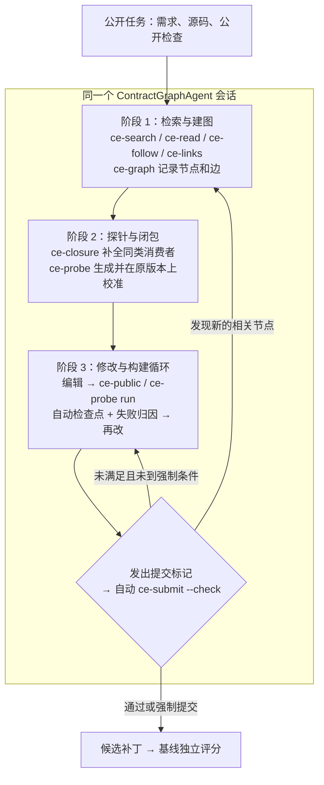

# ContractEdge 重构方案（第二版）：契约图驱动的跨工件修复

日期：2026-11-08　　起草：张耀文　　协作：许洪杰　　状态：方案稿，待师兄与老师审阅

本版在第一版《ContractEdge 重构方案》的基础上，加入了当前进度，以及对基线运行框架、基线控制器和 TopoMen 代码的实地核实结果。方向不变，具体改动如下：

| 改动 | 第一版 | 第二版 |
|---|---|---|
| 执行器的实现方式 | 不改执行器，只通过提示、容器命令和提交检查来增强 | 写成 mini-swe-agent `DefaultAgent` 的**子类**，只重写两个方法（执行动作、判断提交），核心循环不动 |
| 停止规则的触发 | 依赖模型主动调用 `ce-submit` | 模型发出提交标记时，由子类**自动执行**提交检查；模型也可以提前自查 |
| 检查点 | 由模型调用 `ce-checkpoint` | 工作区有变化时**自动**打检查点，不移动 HEAD、不进入补丁；回滚仍由命令触发 |
| B 组（无契约图对照） | 单独搭建"同框架 Live" | 所有机制都关闭时，新方法就是 Live 本身。B 组改为**同期重跑 Live**，第 1 周的验收改成核对配置是否一致，加 3 例冒烟 |
| 接入基线管线 | 待核实 | 已核实：需要改动的登记点约 7 处，监督、计费、评分逻辑不动（见第三节） |
| 对照组 | A、B、C、D | 增加 E 组（关闭停止规则）和 F 组（Live 只加提交机制，用于分离契约图自身的贡献）；不做全部 150 例的全量评测 |
| 新增约束 | — | 工具状态一律写在 `/testbed` 之外；框架身份校验要补上 mini-swe-agent 包；改动前备份服务器上的框架源码 |

---

## 一、当前进度（截至 11 月 8 日）

| 事项 | 状态 | 说明 |
|---|---|---|
| 基线三方法全量运行与差异分析 | **已完成** | 450 个位置全部闭合；差异分析与逐例原因见 `baseline-differential-20261108/` |
| 前半程瓶颈诊断实验（3 轮） | **已完成** | 12 例；累计花费 30.64 元，上限 60 元。结果见第二节 |
| 前半程代码（定位首轮修复、Diagnosis 放行） | **已实现，未提交** | 相关测试 71 项通过。完整回归 3416 项通过，36 项失败与改动前的 `139f6a6` 完全相同。本地与服务器上的工作树一致 |
| 重构方案第一版 | **已完成** | 第十二节 6 项待确认 |
| 接入可行性核实 | **已完成（只读）** | 读了本地留存的基线控制器（10 月 22–25 日的恢复副本）和 TopoMen 源码；在服务器上只读确认了框架版本和配置 |
| 新子包代码 | **未开始** | — |
| 新方法真实运行 | **未开始** | — |
| 服务器当前部署的控制器与本地副本是否一致 | **未核实** | 列为第 0 步 |

---

## 二、为什么要重构（依据）

| 发现 | 数据 | 出处 |
|---|---|---|
| 当前系统输在动手之前 | 32 次运行中 19 次停在编辑前；进入编辑的 13 次中 10 次通过 | 11 月 4 日真实验证 |
| 前期检查是主因，而非截断 | 给全正确位置的源码，仍只有 2/12 走到修改计划；放开残余缺口后上限组到 9/12 | 11 月 8 日上限对照与放行实验 |
| 修了检索又被额度卡住 | 首轮交付 10/12，但 7/12 调用耗尽，只有 3/12 走到修改计划 | 11 月 8 日定位修复 |
| 强基线的优势是交付效率 | Live 在 12 例面板上通过 11/12，旧版 ContractEdge 4/12；SWE-agent 输给 Live 的 47 例中，25 例补丁其实已正确，但一次都没有提交 | 基线差异分析 |
| 通用方法覆盖不到的地方 | Live 失败 28 例，其中改错 9 例（公开检查信号弱、破坏原有行为）、修对却没提交 8 例；三种方法都没修对的 26 例中，17 例没有任何正确补丁 | 基线差异分析 |

结论：多段式"诊断 → 计划 → 受限编辑"链路过长、关卡过多，交接时会丢失信息。跨工件建模的价值，应体现在通用方法做不好的地方：改得是否完整、有没有引入回归、修对之后能不能及时提交。

---

## 三、实地核实结果及其对方案的影响

### 3.1 Live-SWE-agent 的实际构成

- 服务器上的 Live 由两部分组成：安装在 venv312 中的 **mini-swe-agent 1.17.5**，以及一份提示配置 `livesweagent.yaml`。Live 的框架目录里只有配置和说明，没有 Python 代码，也没有 git 元数据。
- mini-swe-agent 1.17.5 的 `DefaultAgent` 核心只有 140 行。判断是否提交的逻辑在 `has_finished`：命令输出的第一行是 `COMPLETE_TASK_AND_SUBMIT_FINAL_OUTPUT` 时结束。
- 基线的 `run_native.py` 中，`live()` 用 `DockerEnvironment` 启动方法容器，具体配置为：
  - 网络为 `none`；
  - 只读挂载 venv312、Python 和框架目录；
  - 公开检查通过挂载的 `/ce-public` 套接字和 `/usr/local/bin/ce-run` 客户端完成；
  - 补丁导出方式为 `git add -N . && git diff <baseline_commit>`。

**影响：**
1. 新方法可以复用同一个 `DefaultAgent`、同一个容器、同一套挂载，只在其上增加一个子类和一份新配置。
2. 所有机制关闭时，新方法与 Live 完全相同，所以 B 组不需要另外搭建。
3. **补丁导出会带上 `/testbed` 下所有未跟踪的文件。** 契约图、探针、检查点等工具状态必须写在 `/testbed` 之外（例如容器内的 `/ce-state`），否则会混进补丁。

### 3.2 基线控制器中需要登记新方法的位置

方法列表在控制器里是硬编码的。按本地副本统计，接入第四种方法 `contractedge-graph` 需要改以下位置：

| 文件 | 现状 | 需要的改动 |
|---|---|---|
| `prepare_ordinary_case.py` | 第 102 行对三种方法逐一准备工作区、档案和任务文本 | 方法列表加入新方法；任务文本与 Live 相同 |
| `codeact_deployment.py` `select_method_images` | 三种方法的镜像映射 | 新方法使用与 Live 相同的镜像 |
| `controller/run_native.py` | 参数 `choices` 和方法分派 | 加入新方法；新增与 `live()` 结构相同的启动函数，改为使用子类和新配置，并加一项只读挂载（工具包） |
| `controller/run_native.py` `is_public_command` | 只对 `ce-public`、`ce-run` 放宽超时 | 加上 `ce-probe`、`ce-submit`，否则会被 120 秒的默认超时截断 |
| `run_outcome.py` | 按方法判断是否完成 | 新方法沿用 Live 的判定（`Submitted`） |
| `score_with_telemetry.py` | 参数 `choices` | 加入新方法 |
| `framework_identity.py` | 只对三个框架目录和 swerex、aiohttp 计算哈希 | 加入新方法的配置目录；**补上 minisweagent 包的文件哈希和版本**（目前没有覆盖，Live 本身的身份校验也有这个缺口） |

`run_remote_method.py`、`freeze_parallel_protocol.py`、计费、结算和评分都按 `enabled_methods` 通用处理，不需要改动。新方法的运行目录可以用已有的 `CE_RUN_VERSION` 机制写入 `attempts-v2/`，不会覆盖历史结果。

**做法：** 不修改已经冻结的控制器。复制一份带新版本号的控制器，在副本上改动，并重新冻结身份。

### 3.3 服务器环境的两个隐患

- **框架源码和 venv 都放在 `/tmp/contractedge-deepseek-preflight-20261019/` 下。** 主机自 2026 年 1 月以来没有重启过，但一旦重启，这些内容可能丢失。改动之前，先把框架目录和 venv 做一份只读备份，并记录哈希。
- **mini-swe-agent 启动时会加载全局配置 `~/.config/mini-swe-agent/.env`。** 需要确认（只查看键名，不输出键值）它不会改变模型参数，并且对 Live 和新方法的作用相同。

### 3.4 TopoMen 的实现方式

TopoMen 本身就是 mini-swe-agent 系的 `DefaultAgent` 子类（`RepairMemoryAgent` / `TopologyRepairMemoryAgent`）。它的三项核心能力都有现成代码：

| 能力 | TopoMen 中的实现 |
|---|---|
| 拓扑与依赖分析 | `build_topology.py`：`TopologyNode`、依赖证据、`TopologyScheduler` |
| 受控执行与回滚 | `_before_action` / `_after_action` 钩子；`_validate_and_restore_dockerfile` 在校验失败时恢复到最近一个合法版本 |
| 失败归因 | `attribute_failure_to_node`：按错误类型把失败映射到拓扑节点，并给出置信度和理由 |

**影响：** TopoMen 的精华可以按同样的方式迁移，即写成 `DefaultAgent` 子类加钩子，不需要另起框架。TopoMen 处理的是环境构建（Dockerfile），节点类型不同，所以只借鉴结构和规则写法，不直接复用其中的规则。

---

## 四、执行器设计

### 4.1 结论

执行器采用 **mini-swe-agent 1.17.5 的 `DefaultAgent` 子类 `ContractGraphAgent`**，加一份新的提示配置（以 `livesweagent.yaml` 为底稿，增加三阶段指引），再挂载一个只读的工具包 `ce-tools`。

| 方案 | 判断 |
|---|---|
| **A. `DefaultAgent` 子类 + 契约图（推荐）** | 与 Live 同框架、同镜像、同管线，唯一的差别是契约图及其衍生机制；TopoMen 用的也是这种结构 |
| B. 改造 TopoMen 执行器 | TopoMen 面向环境构建，节点体系和工具需要大改；可取的部分按 A 的方式迁移即可 |
| C. 重新写一个循环 | 需要重新调试，也无法与基线直接对照 |

### 4.2 子类只重写两个方法

| 方法 | 新行为 | 开关 |
|---|---|---|
| `execute_action` | 1. 执行命令；2. 工作区有变化时自动打检查点（`git stash create` 加 `update-ref refs/ce/ckpt/N`，不移动 HEAD、不改工作区）；3. 如果是公开检查、构建或探针命令并且失败了，就把归因结果（对应的图节点或边、理由）附在观察结果后面 | `checkpoint`、`attribution` |
| `has_finished` | 识别到提交标记时，在容器内执行 `ce-submit --check`：<br>- 通过，或达到强制提交条件 → 正常提交；<br>- 未通过 → 不结束，把未满足的具体项作为观察结果返回给模型 | `stop_rule` |

其余机制通过提示和容器命令提供，由配置开关控制：
- `graph`：契约图与 `ce-graph`；
- `linkers`：静态连接器；
- `closure`：同类消费者闭包；
- `probes`：契约探针。

**全部开关关闭、并使用原版 `livesweagent.yaml` 时，新方法的行为与 Live 相同。**

### 4.3 预算与 Live 保持一致

- 墙钟：从第一次模型请求开始计时 1800 秒，由基线监督进程执行。
- 模型和采样参数相同：`deepseek-flash`，`max_tokens=16384`。
- 不设步数和费用上限：`step_limit=0`、`cost_limit=0`，与基线运行时的覆盖设置相同。
- 资源限制、网络和挂载与 Live 相同，只多一个只读的 `ce-tools` 挂载。

---

## 五、现有 ContractEdge 的去留

| 现有部分 | 新方案中的处理 |
|---|---|
| 问题定义：语义角色、期望/违反关系、五类协调关系 | **保留**，作为契约图的节点角色和边类型 |
| 统一查阅工具 `SourceNavigator`（搜索、完整声明读取、固定版本依赖追踪；含本周修复） | **保留**，封装成 `ce-search` / `ce-read` / `ce-follow` |
| 源码记录与身份校验（路径、坐标、哈希） | **保留**，用于校验契约图节点的锚点 |
| 公开执行隔离、提交规则、可编辑范围 | **保留**，直接使用基线已有的机制 |
| 预算、费用账本、运行记录 | **保留**，直接使用基线的计费与结算 |
| 候选保护与回滚 | **保留**，合并进自动检查点 |
| 独立评分、数据分区与留出集、12 例定位标注 | **保留**；定位标注用于评估契约图的节点召回 |
| 字段契约注释、读取引用等词法提示 | **部分保留**，并入静态连接器 |
| Diagnosis 报文、ChangeSet 报文、多级证据门、格式纠错链 | **不进入新方案**，旧流程保留做对照 |
| 前半程定位助手（独立会话） | **不单独保留**，其工具由执行器直接调用 |
| 本周的定位首轮修复（`salvage_action`、目录概览、未知类型处理、根目录范围归一） | **建议提交**；新方案的 `ce-search` 和 DeepSeek 标记恢复要用到 |
| 本周的 Diagnosis 放行改动 | **建议不提交**，作为实验记录保留 |

---

## 六、TopoMen 精华的接入方式

| TopoMen 能力 | 新方案中的形态 | 借鉴的 TopoMen 代码 |
|---|---|---|
| 拓扑与依赖分析 | **契约图构建**：静态连接器从依赖证据给出候选节点和边，形成有向图；沿图计算闭包和影响范围 | `TopologyNode` 与证据项结构、`TopologyScheduler` 的调度思路 |
| 受控执行与回滚 | **自动检查点**：工作区每次变化都记录；公开检查或探针的结果变差时，`ce-rollback` 回到最好的候选；`ce-submit` 强制提交时取最好的候选 | `_after_action` 钩子；"恢复到最近合法版本"的做法 |
| 失败归因 | **边级归因**：把构建报错的文件和行号、渲染差异、未通过的探针映射到契约图的节点或边，附带置信度和理由，作为下一轮的修改提示 | `attribute_failure_to_node` 的规则结构与 `FailureAttribution` 字段 |

TopoMen 的单步编辑限制、Dockerfile 专用规则和修复记忆，本轮不接入。

---

## 七、新架构

### 7.1 总体流程



三个阶段由提示指引，不设硬关卡。唯一的硬检查在提交时执行。

### 7.2 契约图数据结构（`contractedge.contract_graph.v1`）

```json
{
  "schema": "contractedge.contract_graph.v1",
  "nodes": [
    {"id": "N1", "role": "CONFIG_DECLARATION", "path": "values.yaml", "anchor": "ingress.annotations",
     "span": [209, 242], "source": "linker:helm_values"},
    {"id": "N2", "role": "PRODUCTION_CONSUMER", "path": "templates/common/ingress.yaml",
     "anchor": "Ingress/gateway", "span": [13, 44], "source": "model"}
  ],
  "edges": [
    {"id": "E1", "type": "PROPAGATION", "from": "N1", "to": "N2", "status": "VIOLATED",
     "note": "N2 未读取 ingress.annotations", "probe": "P1"}
  ],
  "preserve": [{"edge": "E3", "scenario": "未配置 annotations", "probe": "P3"}],
  "closure": [{"of": "E1", "candidate": "N3", "decision": "NEEDS_FIX"}],
  "unknown": [{"question": "是否还有第三个 Ingress 模板", "check": "ce-search --scope templates --text 'kind: Ingress'"}]
}
```

- **节点角色**：配置声明、生产消费者、生成状态、运行时消费者、观察状态。
- **边类型**：传播、转换、绑定、同步、协调收敛。**边状态**：`EXPECTED / VIOLATED / UNKNOWN`。
- **程序硬校验只有一项**：节点的路径和行段真实存在，并与当前源码一致。其余内容由模型维护，程序只检查格式。
- 图保存在 `/ce-state/graph.json`，不在 `/testbed` 内。

### 7.3 容器内命令（`ce-tools`，只读挂载，用挂载的 venv312 解释器运行，不联网）

| 命令 | 作用 | 实现 |
|---|---|---|
| `ce-search` / `ce-read` / `ce-follow` | 搜索、完整声明读取、依赖追踪 | 封装现有 `SourceNavigator` |
| `ce-links <种子>` | 静态连接器：给出跨工件的候选边 | 新写，见 7.4 |
| `ce-graph add/show/validate` | 维护和校验契约图 | 新写 |
| `ce-closure <边>` | 沿图列出同类消费者候选 | 新写 |
| `ce-probe gen/calibrate/run` | 契约探针的生成、在原版本上校准、运行 | 新写；通过 `ce-run` 执行 |
| `ce-rollback [检查点]` / `ce-ckpt list` | 查看检查点、回滚 | 新写；检查点由子类自动记录 |
| `ce-public` / `ce-run` | 公开检查与项目命令 | 基线已有 |
| `ce-submit --check` | 覆盖检查加提交规则检查 | 新写；子类在提交时自动调用 |

### 7.4 静态连接器（第一批）

| 连接器 | 规则 |
|---|---|
| Helm | `values.yaml` 键 ↔ 模板中的 `.Values.x`、`include` / `tpl` 引用 |
| Kustomize | 补丁、覆盖 ↔ 目标资源 |
| Go 结构体 | `json:"x"` / `yaml:"x"` 标签 ↔ 字段的读写点、构造函数参数 |
| CRD / API 类型 | 类型字段 ↔ 控制器中的引用 |
| ConfigMap、环境变量、命令行参数 | 键名 ↔ 读取代码（`os.Getenv`、flag 定义等） |
| 依赖 API | 本项目调用点 ↔ 固定版本依赖中的定义（复用 `follow_dependency`） |

连接器负责给出**高召回**的候选，模型负责确认和补充。

### 7.5 契约探针

- **生成**：对所有 `VIOLATED` 边和 `preserve` 项一次性批量生成。优先使用渲染级和静态级检查，必要时才写最小单测，并合并到同一个包里运行。公开检查已经输出相应行为的边，直接复用公开检查。
- **校准**：在原版本上运行一次。违反边的探针必须失败，保持边的探针必须通过；不满足的丢弃并记录。
- **成本上限**：探针总耗时不超过墙钟的 20%，相关调用不超过总调用的 15%；超出时退回"公开检查通过即停"。
- **防卡死**：已校准的探针多次失败、但公开检查通过时，标为可疑并记录，不无限阻止提交。
- **防泄漏**：只使用公开材料，不读取、不模仿隐藏评分。

### 7.6 停止规则（`ce-submit --check`）

满足以下全部条件即通过：
1. 公开检查通过；
2. 所有已校准的违反边探针都通过；
3. 所有保持边的探针结果不变；
4. 闭包中标为需要修复的候选都已修改，标为不需要修改的都写了理由；
5. 补丁符合提交规则。

`UNKNOWN` 边不阻止提交，会写入运行记录。

**强制提交**（回滚到最好的候选后提交），满足任一条件即触发：
- 墙钟用到 85%；
- 连续两次提交检查失败，且未满足项没有变化。

全量测试最多跑 2 次。

针对 Live"修对却没提交"的 8 例：只要公开检查和已校准的探针都通过，就不再要求额外验证。

### 7.7 代码目录

```text
system/src/contractedge/graph_repair/
  config.py        # 方法配置与机制开关（用于消融）
  agent.py         # ContractGraphAgent(DefaultAgent)：重写 execute_action、has_finished
  prompts/         # 以 livesweagent.yaml 为底稿的三阶段配置
  graph/           # schema.py  store.py  validate.py  closure.py
  linkers/         # helm.py  kustomize.py  go_tags.py  crd.py  env_flags.py  deps.py
  probes/          # spec.py  generate.py  calibrate.py  run.py
  attribution.py   # 失败归因到节点或边
  checkpoint.py    # 自动检查点与回滚（基于 stash create + update-ref）
  submit.py        # 停止规则与提交规则检查
  cli/             # ce-search ce-read ce-follow ce-links ce-graph ce-closure ce-probe ce-rollback ce-submit
  harness/         # 接入基线控制器的启动函数与登记补丁
system/tests/graph_repair/
```

旧代码不删除、不改动。新子包只引用 `source.navigation`、`diagnosis.evidence` 中的源码记录、`orchestration.candidate_guard`、`dataset.benchmark` 等底层模块。`ce-tools` 打包成自包含目录，只依赖 venv312 中已有的库。

---

## 八、实施计划（三周，与师兄分工）

### 8.1 分工（建议，待确认）

| 负责人 | 模块 |
|---|---|
| 张耀文 | 控制器副本与新方法登记、`ContractGraphAgent`（检查点、提交检查）、`ce-tools` 打包与挂载、评测与消融、文档 |
| 许洪杰 | 契约图结构与校验、静态连接器、同类消费者闭包、契约探针、失败归因规则 |
| 共同 | 第 0 步冻结、接口评审、第 3 周的实验分析 |

两人之间的接口是**契约图 JSON 结构**、**命令的输入输出格式**，以及 **`ce-submit --check` 的返回结构**，第 1 周第 2 天前冻结 v1。

### 8.2 时间线

**第 0 步（第 1 周第 1 天）：冻结与现场核对**
- 比对服务器当前部署的控制器与本地副本，记录差异。
- 备份 `/tmp/contractedge-deepseek-preflight-20261019/` 下的框架目录和 venv，记录哈希。
- 确认全局配置 `.env` 的键名，不输出键值。
- 冻结评测名单：
  - 12 例面板；
  - Live 改错的 9 例；
  - Live 修对却没提交的 8 例；
  - 无人修对的 17 例中与上面不重叠的部分；
  - 8 例留出集；
  - 约 20 例 Live 已修好的案例，作为"不退步集"。
- 按决定处理本周未提交的代码：定位修复提交，放行改动不提交。
- **完成标准**：名单、备份清单和哈希都已入库。

**第 1 周：接入与骨架**

| 天 | 张耀文 | 许洪杰 |
|---|---|---|
| 1–2 | 控制器副本中完成 7 处登记；`ContractGraphAgent` 空壳（全部开关关闭） | 契约图 JSON v1、`ce-graph`、锚点校验 |
| 3 | `ce-tools` 只读挂载，确认容器内能用 venv312 运行；`ce-search/read/follow` 封装 | Helm、Go 标签连接器 |
| 4–5 | 自动检查点与 `ce-rollback`；全关版本冒烟 3 例 | CRD 连接器、`ce-links`；12 例上候选边的召回 |

- **第 1 周完成标准**：
  1. 全关版本与 Live 的配置逐项比对一致（只有方法名和多出的只读挂载不同），并真实运行 3 例，步数和结果与 Live 在同一量级；
  2. 框架身份校验已覆盖 minisweagent 包；
  3. 工具状态不会出现在导出的补丁里（单元测试加冒烟验证）；
  4. 连接器在 12 例上对金标节点的召回有初步数字。

**第 2 周：契约机制**

| 天 | 张耀文 | 许洪杰 |
|---|---|---|
| 1–2 | 三阶段提示配置；`has_finished` 接入 `ce-submit --check` 和强制提交 | `ce-probe gen/calibrate/run`（渲染级优先） |
| 3 | 归因结果接入 `execute_action`（与师兄联调） | `ce-closure`；Kustomize、环境变量、依赖连接器；归因规则 |
| 4–5 | 用模拟模型做集成测试；真实试跑 3 例并调整预算 | 在原版本上校准 12 例的探针，统计可用率和误判率 |

- **第 2 周完成标准**：
  1. 完整版在 12 例面板上跑完一轮；
  2. 单独报告探针在调用、token 和耗时上的占比；
  3. 没有因为前期检查而停止的运行。

**第 3 周：对照、消融与总结**

| 组 | 配置 | 样本 | 次数 |
|---|---|---|---|
| A | 完整版 | 全部评测名单 | 2 |
| B | Live（同期重跑，与 A 交错进行） | 全部评测名单 | 2 |
| C | 关闭探针 | Live 改错的 9 例、多消费者案例 | 2 |
| D | 关闭闭包 | Live 改错的 9 例、多消费者案例 | 2 |
| E | 关闭停止规则（公开检查通过即停） | Live 修对却没提交的 8 例、改错的 9 例 | 1 |
| F | Live 只加提交规则检查与强制提交，不加契约图、探针、闭包 | Live 修对却没提交的 8 例、违反提交规则的 6 例、改错的 9 例 | 1 |
| 留出集 | A 与 B | 8 例 | 1（只用一次） |

- **指标**：
  - 端到端修复率；
  - 修好且不引入回归的比例；
  - 多消费者案例的漏改率；
  - 不退步集上的保持率；
  - 修对之后的提交率；
  - 调用次数、token、费用、耗时；
  - 探针拦下的错误修改数。
- **判定**：A 相对 B 的差距必须大于同组两次运行之间的波动。C、D、E 用来说明各机制的贡献；A 相对 F 的差距才是契约图自身的贡献（F 只含通用的提交机制）。所有失败和退步都保留，并逐例解释。
- **产出**：实验报告，以及论文方法、实验章节的草稿。

---

## 九、测试与验收

| 层次 | 内容 |
|---|---|
| 单元测试 | 图结构与锚点校验；每个连接器的正反例；探针校准逻辑；停止规则的各条件组合；检查点不移动 HEAD、不进入补丁；回滚 |
| 集成测试 | 用模拟模型走完三阶段与提交拦截；用 2–3 个真实开源案例的小片段做连接器回归 |
| 接入验证 | 全关版本与 Live 的配置比对；控制器副本的身份冻结；`is_public_command` 的超时覆盖 |
| 真实试跑 | 每周固定 3 例，观察步数、调用和墙钟分布，防止出现 SWE-agent 式的超时 |
| 回归保护 | 旧流程的测试保持原状；完整回归中已知的 36 项历史失败单独列出 |

---

## 十、预算估计

| 项目 | 估计 |
|---|---|
| 已花费（诊断实验） | 30.64 元 |
| 第 1、2 周的冒烟与试跑 | 约 20–40 元 |
| 第 3 周对照与消融（约 55 例；A、B 各 2 次约 220 次运行；C、D、E、F 约 90 次；留出集 16 次） | 约 170–220 元 |
| 合计（不含已花费） | 约 190–260 元 |

估算依据：Live 在本数据集上每次运行约 0.39 元，新方法按多 40% 估为约 0.55 元。实际以账本为准，每次运行前检查余额。

---

## 十一、风险与应对

| 风险 | 应对 |
|---|---|
| 新方法与 Live 差不多，体现不出增益 | 重点评测 Live 改错、修对未提交和无人修对的案例；报告漏改率、回归率和提交率，不只看总通过率 |
| 契约图与探针成本过高、导致超时 | 探针时间不超过墙钟的 20%，超出就退回"公开检查通过即停"；每周试跑监控 |
| 探针写错，误导修改或卡住提交 | 在原版本上校准；可疑探针不无限阻止提交 |
| 提交拦截让模型陷入循环 | 连续两次未满足项不变就强制提交；85% 墙钟时强制提交 |
| 服务器控制器与本地副本不一致 | 第 0 步先比对；改动只在带版本号的副本上进行 |
| `/tmp` 下的框架源码丢失 | 第 0 步备份并记录哈希 |
| 工具状态混进补丁 | 状态一律写在 `/ce-state`；单元测试和冒烟双重检查 |
| DeepSeek 工具调用标记导致回复无法解析 | 复用本周的 `salvage_action` 恢复方案，并统计恢复次数 |
| 两人并行开发时接口不一致 | 第 1 周第 2 天前冻结接口；每周两次联调 |

---

## 十二、需要确认的问题

1. **执行器**：是否同意采用 `DefaultAgent` 子类加契约图增强（第四节）？与第一版相比，本版允许重写两个方法，核心循环不动。
2. **分工**：8.1 节的分工是否合适？师兄更希望负责哪一块？
3. **运行管线**：是否同意复制一份基线控制器，在副本中登记第四种方法（约 7 处改动，见 3.2）？已冻结的原控制器不动。
4. **评测名单**：是否同意加入"Live 修对却没提交的 8 例"和约 20 例"不退步集"？
5. **预算**：后续约 190–260 元是否可以？是否需要设硬上限？
6. **论文定位**：对外是否将"契约探针 + 同类消费者闭包 + 覆盖停止规则"作为三个主要贡献？需要老师确认。
7. **本周未提交的代码**：是否按建议处理，即定位首轮修复提交、Diagnosis 放行不提交？
