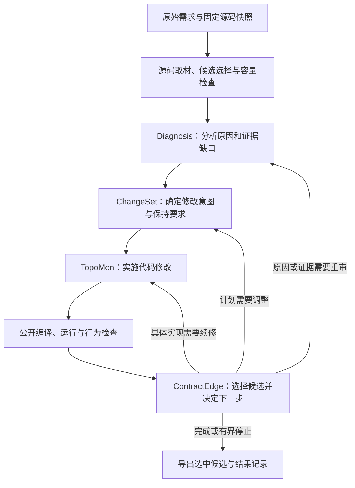

**ContractEdge 系统研发进展与后续优化计划**

汇报日期：2026年11月4日  
当前阶段：系统机制优化与小规模验证，尚未进入正式全量实验  
当前就绪状态：`formal_ready=false`

本报告说明系统的核心流程、已有实验与代码进展、当前瓶颈，以及下一阶段的修改和验收安排。报告中的“已修复”指相应代码缺陷已在指定版本落实；“工程验证通过”指程序行为符合测试要求；“真实效果提升”则必须由真实模型和独立行为评价确认，三者分别报告。

**一、当前进度与总体判断**

前期已完成150条数据集上三个baseline的运行，实验运行基础已经建立。当前工作重点是提高ContractEdge本身的修复能力和跨阶段稳定性；数据标签的清晰度与可解释性可另行完善，不作为本轮主要优化方向。

目前已经完成多轮代码审查、部分底层修复和小规模真实模型对照。结果表明，系统存在局部收益，但尚未形成可靠的整体提升。主要瓶颈集中在两段：

- **执行前：取材、材料准入与Diagnosis纠错。** 关键源码可能未被发现、首次读取不完整、受到相互独立的容量限制，或在材料已送达后仍产生不合法诊断输出。
- **执行后：候选选择与续修控制。** 回滚保护虽然已有实现，但当前真实面板入口未启用；下一阶段决定仍分散在多个位置，存在策略覆盖。

下一阶段将围绕这些共同机制修改代码，保留Diagnosis、ChangeSet、TopoMen三个核心组件，不以某个困难案例必须通过、或150条全部通过作为优化目标。

**二、系统核心设计与实际运行流程**

ContractEdge将修复任务分为三个核心职责：

| 核心组件 | 主要职责 | 需要发挥的作用 |
|---|---|---|
| Diagnosis | 根据需求、源码和公开观察分析原因，识别关系及证据缺口 | 明确为什么需要修改，避免仅凭表面报错猜测 |
| ChangeSet | 表达修改意图、修改范围、需要保持的行为及未解决事项 | 将原因分析转为可执行、可检查的修复计划 |
| TopoMen | 根据接受的计划实施具体代码修改 | 完成编辑，并接收后续编译、运行及行为反馈 |

总体流程如下：

源码取材、证据保存、容量预算、模型调用、状态记录和候选回滚是三个核心组件共用的支撑代码。它们决定模型实际看到了什么、下一步是否可以执行，以及最后保留哪个修复结果。因此，本轮不少修改位于组件之间的连接代码，而不是修改核心方法的职责划分。

当前TopoMen执行的是一次受限编辑，后续续修由ContractEdge控制；它尚不具备自主进行多步仓库搜索和命令执行的完整能力。回滚机制已有实现，但当前真实面板未接通相应候选保护，不能把流程设计中的能力等同于实际已经启用的能力。

**三、已经完成的工作及实验结果**

**1. 已落实的工程修复。** 已核对的修复包括：已采用证据的跨阶段完整交付、源码展示窗口与原文件坐标分离、错误分类、执行状态与语义状态区分、保留原始运行失败和清理失败、模型实际发送状态记录、成功恢复产物来源绑定，以及可信用量结算。

这些修复提高了程序行为的正确性和可解释性，但不自动等于真实模型修复率提高。例如，“已采用摘录没有在后面丢失”并不意味着“第一次读取时就拿到了完整函数”，后者仍是本轮待处理事项。

**2. 已完成关键源码访问修复。** 最新候选代码补充了本地调用者、构造器、接收者相关声明和固定版本依赖API的读取。已有请求回放确认：KPT案例的四段关键函数、Helm案例的三条依赖API声明可以完整进入准备发送的请求。该候选已完成工程核验，但尚无新的真实模型整案效果成绩。

**3. 最近一次已完成的真实对照。** 使用DeepSeek接口，对固定8个案例执行新旧两组对照，共16次整案运行。这里的16次是实验运行槽数，不是模型请求次数；每个案例可能包含多次模型调用。

| 指标 | 已完成结果 |
|---|---:|
| 当轮候选版本通过独立行为评价 | 3/8 |
| 当轮对照版本通过独立行为评价 | 2/8 |
| 候选相对对照改善 | 2例 |
| 候选相对对照退步 | 1例 |
| 两组共同通过 | 1例 |
| 两组共同未通过 | 4例 |

候选组的5个未通过案例均未进入实际编辑执行。进入执行的3个案例通过了独立评价，说明该小面板的主要损失发生在前半程；但样本不足以说明TopoMen或后半程已经最优。存在一例退步，也说明不能仅根据总通过数多1例，就宣布稳定提升。

**4. 版本与验证边界。** 为避免混用成绩，当前区分三份代码：

| 版本 | 用途与状态 |
|---|---|
| 已安装版本 `063d12e` | 当前安装目录中的版本；与后续候选分开保留 |
| 已完成真实对照版本 `806e29f` | 上述3/8对2/8结果对应的候选版本 |
| 最新工程候选 `e6784c1` | 含后续源码访问及准入修复；已工程核验，尚未安装、尚未取得新的真实整案成绩 |

后文四步中的新增修改尚未实施，不能将过去的工程测试和真实成绩计为这些新修改已经通过。

**四、当前主要问题及定位依据**

| 问题类别 | 已核实情况 | 对修复过程的影响 |
|---|---|---|
| 首次取材不完整 | 普通抽取默认受80行、16000字符限制；部分声明在补证筛选时就会因截断被淘汰 | 后续完整传递一段摘录，仍可能缺少函数尾部的关键逻辑 |
| 源码发现不足 | 旧KPT流程中四段关键函数没有进入候选池；旧Helm诊断缺少所需依赖读取入口 | 模型无法基于未找到的实现建立完整解释；该部分已有候选修复，收益待验证 |
| 容量与条数限制不一致 | 请求窗口、源码支持字节数、候选条数和补证累计额度独立存在 | 只增加模型窗口可能仍被另一道限制拦下 |
| 词法提示过度强制 | 普通字段名称与需求匹配，会经两条路径升级为必须送达的材料 | 弱相关材料可能占据必需名额，增加不必要的阻断 |
| 诊断输出与纠错边界 | 存在关系结构不合法、空白检索提示被接纳、扩展阶段共享一次纠错等情况 | 材料到位后仍可能停止；不能统一解释为上下文缺失 |
| 停止原因记录不一致 | 系统未送达材料仍可能投影成模型证据不足；异常返回可能遗漏检索轮次 | 难以准确判断失败发生在哪个环节，也影响优化归因 |
| 候选保护未接入 | 当前真实面板配置没有启用已有回退比较 | 后一次修改退步时，可能导出更差的最后候选 |
| 路由职责分散 | feedback先给路线，repair可修改，下一轮还可能再次覆盖 | 局部进展可能被另一条规则触发的重诊打断，需要统一优先级 |

典型案例进一步说明了原因差异：

- **Certmanager：容量阻断已精确测量。** 同一历史草案需要100826字节源码支持，超过100000字节上限826字节；提高到200000后原样准入。它证明容量门槛解除，不证明模型最终修复成功。
- **KPT4746：旧问题是没有发现关键函数。** 相关四段声明原先未入候选池，不能归为发送时截断。
- **KPT4673：材料已经送达，最终关系结构仍不合法。** 扩大容量不能直接修正这类输出错误；该案例在对照组通过，不能将候选失败解释为案例本来无解。
- **CloudWatch：模型继续寻找可能需要新增的实现。** 系统代码已允许有依据地新增helper，不能误判为执行权限禁止新建函数。

“证据缺口”应表示一个具体判断仍缺少可核对的事实，例如缺少配置值从入口传递到客户端的中间调用关系。它不应同时代指材料截断、容量不足、未发送或非法模型输出。

**五、控制流程的三个新发现与原问题清单的关系**

前期十一项问题是全系统的工作清单；本次三个控制发现主要是其中第10项“编排与控制流程”的细化，并非额外增加三套独立任务。

| 控制发现 | 证据与判断 | 后续处理 |
|---|---|---|
| 候选回退保护未在当前面板启用 | 同源码、同固定回复的整链离线实验：关闭时导出第二轮退步补丁，开启时实际恢复上一候选；两组均未误判为语义成功 | 必须修复实际入口和保护集合来源 |
| 下一步决定分散、多处改写 | 实际代码调用链已核对；已有transitions文件仍主要消费其他位置决定的路线 | 先等价收拢到一个最终决策入口，再独立调整策略 |
| 部分进展可能被前提重审覆盖 | 路径重叠已用纯函数反例复现，但尚未证明降低真实模型效果 | 核对失败与前提的关联，保留必要重审，不直接删除规则 |

这里的回滚对照使用固定回复，没有新增真实模型请求。它证明配置会影响保留哪个候选，不证明历史某个真实案例已经因此退步，也不证明启用保护必然提高最终通过率。

**六、后续四步修改与验收安排**

| 顺序 | 要解决的问题 | 核心修改 | 完成判据 |
|---|---|---|---|
| **第一步：候选保护与事实记录** | 退步补丁覆盖上一候选，失败原因和检索记录不一致 | 在真实benchmark入口启用现有比较与回滚；明确保护检查；统一交付失败状态，保留准确门槛及轮次 | 同一退步反例被正确回滚；允许的目标变化不被误拒；源码、观察、反馈、导出补丁一致；停止原因可以核对 |
| **第二步：完整取材与一致准入** | 首次内容不完整、筛选前已淘汰、普通线索被强制、额度口径不一致 | 初选和补证筛选前共用完整声明读取；同一来源保持身份；同时收窄词法强制的两条路径；同维度共用容量配置 | 长函数关键尾部实际进入请求；放不下时明确报告；真正必需材料及已采用正文仍保留；KPT/Helm已修取材不退步 |
| **第三步：统一路由与诊断纠错** | 多处决定下一动作，无关联规则重置进展，不可行动缺口消耗预算 | 一个入口决定最终动作；repair负责执行；校验空白定位提示；精确返回关系错误；保留已有新建实现路径 | 记录动作与实际派发一致；实现、计划和原因问题回到合适阶段；旧诊断不冒充新快照；局部通过不关闭剩余义务 |
| **第四步：冻结后的真实效果验证** | 工程通过与真实收益混淆，代码和容量变化无法区分 | 冻结代码、配置、输入与模型设置；旧新版同容量比较；同新版源码比较容量；保留全部失败和退步 | 有独立行为评价支持的收益，关键退步得到解释或修正；交付、终态、成本与耗时均可核查，并检查未参与调参案例 |

第一至第三步主要涉及`source`、`retrieval`、`diagnosis/evidence.py`、`orchestration/runner.py`、`repair.py`、`feedback.py`、`transitions.py`及已有校验和状态模块。目标是复用已有入口、减少重复判断，不增加面向模型或数据集的额外标签体系。

对于词法强制规则，保留以下边界：名称相似用于发现和排序；明确端点与已采用材料必须保留；已送达源码约束由ChangeSet判断是否适用。不能自动删除反证，也不能替模型把约束全部判为不适用。

本轮默认不增加诊断纠错次数，也不扩大TopoMen权限。只有后续结果显示共同失败集中在执行阶段，且自主搜索、读取或编译确有必要时，才开展有限多步能力的独立对照。

**七、验证方法与正式实验进入条件**

验证分为两层：

1. **工程层：**每类修改先用已有反例和必要回归检验。确认目标缺陷消失，原有快照、证据、编辑权限、预算和保持要求未被破坏；整合候选再完成规定工程检查与独立复核。
2. **效果层：**冻结后进行真实模型比较，报告独立行为通过数、成对改善与退步、执行前停止原因、候选回退、实际模型用量、费用和耗时。

实验可以组织为“旧版原容量／新版原容量／新版扩容”三组，复用新版原容量组作为对照。前两组用于观察整组工程修改效果，后两组用于观察容量效果，不能把所有收益归给某个单独参数。具体实验登记以实际完成的冻结候选为准；已有登记和历史结果保持不变。

先使用现有固定八案例检查已知故障链，再用未参与调参的公开案例检查收益是否能够延续。八案例不能代表全部150条；不按隐藏答案选择有利案例，不将频繁调试同一小面板的收益直接推广为整体结论。

进入正式实验前，需要同时满足：

- 已确认的确定性缺陷关闭，完整材料交付和实际候选保护通过验收。
- 系统只产生一个可解释的最终下一步决定，记录与实际执行一致。
- 冻结版本具有可核查的真实收益，关键退步得到解释或修正，并完成必要的未调参案例检查。
- 版本、输入、预算、失败结果与评价过程可复查，运行费用和时间可控。

完成标准不要求150条全部成功，也不要求Dapr等特定困难案例必须通过。工程正确性可以逐项验收；真实效果提升的幅度须由实验决定，不能提前承诺。

**八、方法依据与当前研究贡献的保留**

此次方案参考了相关原始论文和官方文档，采用其中适合当前问题的原则：

| 参考方法 | 借鉴内容 | 在本系统中的使用范围 |
|---|---|---|
| [Agentless](https://arxiv.org/html/2407.01489v1) | 从文件、函数到编辑位置的分层定位 | 定位索引帮助找位置，实际源码支持诊断，不新增多套复杂定位模型 |
| [SWE-agent](https://arxiv.org/html/2405.15793v1) | 高效工具动作、明确环境反馈和错误处理 | 改善读取、编辑和纠错接口，不照搬其历史上下文压缩策略 |
| [Aider repo map](https://aider.chat/docs/repomap.html) | 利用符号与依赖关系定位相关代码 | 索引是线索，不替代已采用证据正文 |
| [SWE-Search](https://arxiv.org/html/2410.20285v1) | 根据反馈调整阶段、避免无效重复 | 借鉴阶段选择和进展判断，不直接引入复杂树搜索及多代理评审 |

这些工作提供设计依据，但其基准成绩不能直接转化为ContractEdge的效果保证。本轮继续保留核心分工：Diagnosis负责原因，ChangeSet负责修改与保持要求，TopoMen负责执行；共用支撑层负责完整材料、准确事实和有界控制。

**九、当前完成状态与下一阶段交付物**

| 工作 | 当前状态 |
|---|---|
| 150条数据上的三个baseline运行 | 前期已完成；本报告不重新汇总三者成绩 |
| 已有证据交接、运行状态、失败记录等底层修复 | 已有版本完成，继续保留其工程保护 |
| 关键源码与依赖访问补充 | 最新候选已工程核验，真实整案效果待验证 |
| 最近固定八案例新旧真实对照 | 已完成，3/8对2/8；有改善也有退步 |
| 本轮进一步审查、控制反例与四步计划 | 已完成 |
| 四步中的新增代码修改与新真实对照 | 尚未实施／运行 |
| 正式全量实验 | 尚未进入，`formal_ready=false` |

下一阶段按四步实施，每一步交付实际修改文件、修改前反例、修改后结果、原保护保留情况和未完成事项；最终交付冻结候选、工程验证记录、真实对照结果及是否进入正式实验的判断。

当前汇报结论是：系统已具备实验运行基础，部分工程缺陷已经修复；当前瓶颈已进一步定位到材料生产与准入、诊断输出和候选控制。后续将以明确反例驱动的代码修改和冻结对照，验证是否取得稳定收益。

**附：本地技术证据索引**

- [当前组件与问题清单](SYSTEM_COMPONENT_ISSUE_MAP_AND_OPTIMIZATION_PLAN.md)
- [进一步深度审查与修改设计](DEEP_PIPELINE_AND_CONTROL_DESIGN_REVIEW.md)
- [四步实施与验收清单](IMPLEMENTATION_AND_ACCEPTANCE_PLAN.md)
- [已完成真实面板的独立核验](analysis/BOUNDED_CONTINUATION_PANEL_RESULTS_INDEPENDENT_AUDIT.json)
- [取材与准入补充审查](analysis/front-material-admission-followup/FRONT_MATERIAL_ADMISSION_FOLLOWUP_REVIEW.md)
- [候选选择、续修与回滚审查](analysis/control-decision-independent-review/CONTROL_DECISION_INDEPENDENT_REVIEW.md)
- [候选保护开关的离线反例](analysis/control-decision-independent-review/GUARD_PROFILE_COUNTERFACTUAL.json)
- [最新候选工程证书](followup/source-access-admission-fix/ENGINEERING_VERIFICATION.json)
