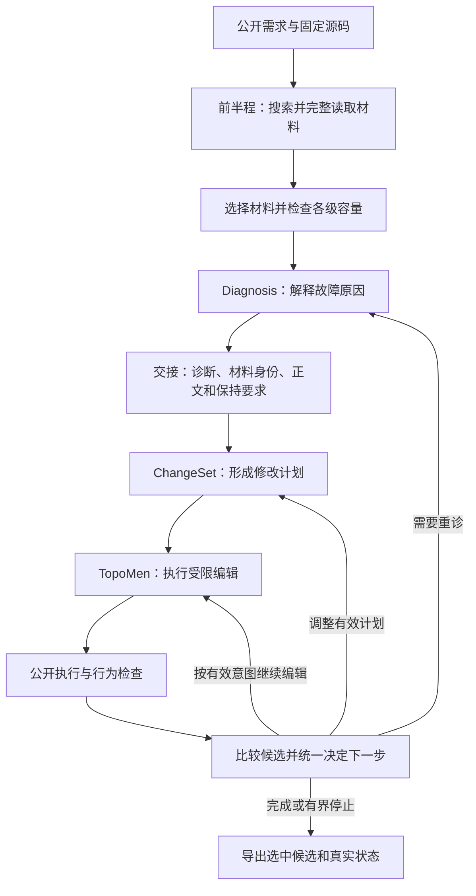

# ContractEdge 当前系统版本与统一问题清单

> 后继设计更新（2026-11-05）：前半程代码实施请使用[新的完整规格](../20261105/FRONT_HALF_REDESIGN_IMPLEMENTATION_SPEC.md)。本页保留15141基线的问题及实验事实；“保留40条候选／只调整补证额度／逐项机制对照”等后继建议已由新规格替代。生产源码及本页历史结果未改变。

更新日期：2026-11-04（北京时间）。本页依据冻结源码、32槽真实验证和已保存的公开回放，统一说明前半程、交接处和后半程的现状。它是协作问题清单，不表示下列后继修复已经实施，也不增加系统运行标签或机制。

**当前用于继续开发的版本是：ContractEdge 0.6.68，四步实施开发候选，生产源码摘要 `15141db3`。目前 `formal_ready=false`。** 本轮代码修改、工程检查和注册验证已经结束，但原十一项问题尚未全部关闭；不能把“四步执行结束”理解为“整体优化成功”。

## 1. 当前究竟是哪一个版本

| 身份 | 当前值 | 应怎样使用 |
|---|---|---|
| Python 包标称版本 | **0.6.68** | 来自 `src/contractedge/__init__.py`；`pyproject.toml` 动态读取此值。它不能单独区分不同实验候选。 |
| 当前开发候选的完整生产摘要 | `15141db36fde55f526e18be0b288a24548b0a91a6c5ce40b7763603aaa4636f4` | 123个生产 `.py/.json` 文件的集合摘要；本轮工程证书和新版真实实验绑定此身份。 |
| 当前候选冻结标签 | `system-15141-fourstep-candidate-20261104` | 后继代码优化以此候选为基线，保留原标签和结果。 |
| 标签实际指向的 Git 提交 | `d842853a9ef0d729c2a965a6481c229fbb04b0fb` | 这是源码冻结提交。注释标签自身另有对象摘要，不要将标签对象误当提交。 |
| 当前协作分支 | `fix/four-step-consolidation-20261104` | 保存相同生产源码及后续更新的结果、问题说明；文档提交不会自动成为新的算法版本。 |
| 已发布32槽验证报告的提交 | `4d317a6d11fbe5a2b09397fe51a8e4d618fd6f5b` | 这是结果发布提交；本页随后新增，具体文档提交以 Git 历史为准。 |
| 协作 PR | [PR #33](https://github.com/xuhhhhjie-pixel/contractedge/pull/33) | 保持草稿，尚未合并主分支或批准正式实验。 |
| 服务器当前开发源码目录 | `/home/xhj/contractedge-four-step-20261104/system` | 当前问题复核及后继分支应使用的源码。 |
| 服务器现有安装副本 | `/home/xhj/contractedge-system` | 仍是旧安装源码，**没有随本轮候选升级**。 |
| 安装副本的完整生产摘要 | `063d12e251278822dc0f316f42f5d20e9411367f9c00c58eea97306c504df4dd` | 121个生产文件；其包标称版本同样是0.6.68，不能据包版本相同断言与候选同版。 |
| 本轮旧版对照 | 摘要 `e6784c1085dc9aaa73226cc82d5a7971322e95f75456f511a820e224c1279538`；标签 `system-e6784-pre-consolidation-20261104` | 真实新旧比较的旧版是这个冻结基线，不是安装目录的063d版本。 |

README历史段落中的0.6.27属于旧说明。沟通本轮系统时，应同时写“**0.6.68／源码15141db3／四步实施开发候选**”，不能只报0.6.68，也不能将它称为已通过正式实验准入的发布版。

版本核验方法见[固定版本核验与协作方式](https://github.com/xuhhhhjie-pixel/contractedge/blob/fix/four-step-consolidation-20261104/system/docs/implementation/20261104/REPRODUCE_AND_COLLABORATE.md)。源码身份之外，模型结果还受冻结配置、样本、模型和预算约束；相同源码使用不同容量配置，不代表同一实验设置。

## 2. 系统流程与目前的总体判断

Diagnosis负责找原因，ChangeSet负责说明怎么改、保持什么，TopoMen负责实际编辑。当前重点是让三者拿到合适且完整的材料、使用一致的引用与控制事实，并非已经证明必须推翻三个核心组件的分工。

本轮固定八案例三组24槽、预选四案例两组8槽均已结束。12个案例的同容量对照中新旧版各通过 **4/12**，一例改善、一例退步；新版调用由49次增至57次，费用由7.028560元增至7.896752元。每案每组仅一次，不能作统计显著或单行代码因果结论。

新版同容量的12案中，**7案在进入TopoMen编辑前停止**，其余5案进入编辑，其中4案独立评分通过。这个分布支持优先处理前半程和交接处，但不证明TopoMen在其他案例上一定足够。

工程检查为3384项通过、4项跳过、90个子测试通过，原生9项和六组公开流程模拟通过。这说明指定工程边界通过检查，不能代替真实修复效果。

## 3. “证据被截断”实际包含哪些不同情况

| 情况 | 大白话解释 | 当前判断 |
|---|---|---|
| 函数正文只读了前面一段 | 找到了函数，但模型只拿到函数开头。 | 本轮已实现初选和补证选择前的完整声明读取；明确的源码窗口仍按窗口处理，不冒充完整声明。 |
| 整个函数被候选池排除 | 扫描找到了，进入后续选择前就被数量上限排除。 | 仍有已确认缺口，见前半程表中的候选池问题。 |
| 完整函数超过内部补证额度 | 已经读全，但系统内部规定一次只能接收较少字节，因而拒绝整个请求继续。 | 仍有已确认冲突。Prometheus第二次请求没有发送，不是模型收到了一份偷偷截短的全文。 |
| 完整请求超过模型或阶段输入限额 | 材料本身可能都齐了，但整个请求装不下。 | 仍需保留明确准入检查；不能用这一类解释所有失败。 |
| 模型自己的回答写到输出上限 | 输入可能完整，但输出JSON没有写完。 | 与输入证据截断分开。Certmanager一次公开复核出现过，已有有界纠错恢复，原截断保留。 |
| 材料已经送到但未被正确使用 | 资料在输入里，模型仍索要同类信息或无法形成合法判断。 | 属于消费者接口、诊断策略或模型判断问题，单纯增加文本量不保证解决。 |

**内部补证的字节额度、模型的token窗口、模型的输出额度是不同限制。** 本轮联合调整了请求窗口、首诊窗口、模型窗口和执行支持容量四项，未修改补证单次24000／累计48000字节。不能据此声称所有容量瓶颈已经验证或解除。

## 4. 前半程的遗留问题

以下代码路径均相对仓库的 `system/src/contractedge/`。表内“需要处理”是后继工作，不是本页已实施的代码。

| 问题与原编号 | 发生了什么、有什么证据 | 相关组件与代码 | 需要处理及验收边界 |
|---|---|---|---|
| 关键函数在候选池被排除；原2 | Certmanager明确请求的函数排第48，原池只留40条；正文仅582字节，未送达不能归为模型窗口太小。 | 取材连接代码：`source/units.py::extract_gap_extension_units` | 在原额度内优先保留同范围明确点名的声明；检查同名、不同receiver、多缺口竞争，最终确认正文实际发送。 |
| 完整声明与补证额度冲突；原3、4 | Prometheus完整main为1282行、52679字节，单个声明已超过单次24000及累计48000字节；新版明确停止。旧版则因不完整必需端点停止。 | 材料准入：`diagnosis/evidence.py::source_extension_limits`、`retrieval/candidates.py`、`orchestration/runner.py` | 选择、采用及恢复共用冻结字节额度；先计算必需全文成本，再分配可选材料。验证原额度停止、足够额度完整准入及其他限额仍有效；不承诺放行即修复成功。 |
| 查询没有回答真正的问题；原2、7 | CloudWatch问目标操作是否存在，函数symbol却覆盖操作搜索词；Helm部分组又被过窄的依赖名称匹配挡住。 | 检索：`retrieval/gap_delivery.py`、`source/absence.py`、`source/dependency.py` | 区分“到哪里看”和“查什么”，围绕真实导入、调用点与固定依赖版本读取。局部无文本不等于全仓库无实现。 |
| 资料送到但用途不明确；原2、6 | Helm另一组已收到三条完整只读API，仍继续索要信息；只读材料的用途说明存在缺口。 | Diagnosis材料接口：`diagnosis/prompt.py`、`adopted_source_context`投影 | 清楚说明参考材料可帮助理解和规划，同时保留因果证据与编辑权限约束。接口缺口已确认，是否是模型失败的唯一原因尚未证明。 |
| Diagnosis对待实现行为和已有事实的判断不稳定；原6、7 | KPT4746已收到关键函数，仍要求可能需要新增的交接；KOPF失败组索要未来修复成功观察。Skaffold还有不受支持的因果判断。 | Diagnosis及校验：`diagnosis/prompt.py`、`contracts/validation.py`、`orchestration/runner.py` | 区分真实缺失事实、待实现功能与修复后验收。不得自动READY、伪造因果或取消校验。Helm Controller索要的是原程序状态观察，应单独判断，不能与未来成功观察混为一谈。 |

KPT4673同容量退步仍保留：旧版通过、新版停止。尚未证明它是关键函数被挤掉导致，也不能因扩容组通过就掩盖该退步。

## 5. 前后半程交接处的遗留问题

| 问题与原编号 | 大白话与证据 | 相关组件与代码 | 需要处理及验收边界 |
|---|---|---|---|
| 纠错漏报已经查出的错误；原6 | Alertmanager计划同时有格式和前提来源ID错误，纠错却只告知格式错误，改完后又被另一个已知错误挡住。原回复回放已复现。 | ChangeSet纠错接口：`orchestration/runner.py`、`contracts/validation.py::compact_validation_feedback`、`changeset/validate.py::_prerequisite_input_issues` | 将能独立、安全检出的错误一并反馈，不增加纠错次数；依赖合法结构的深层检查仍分阶段执行。 |
| 同一材料存在两个身份；关联原6、10 | 同快照、同行范围、同正文与摘要的材料出现两个ID，前提审查只接受其中一个。正文并没有丢失。 | 材料投影与前提引用：`diagnosis/evidence.py`、`orchestration/runner.py`、`changeset/validate.py` | 规范同一物理材料的展示和引用来源，保留已采用身份；禁止靠去字符串前缀或近似匹配猜映射。尚未证明这是整案失败的唯一原因。 |
| 准备状态与真实发送容易混淆；原8 | Prometheus失败草案中部分行写delivered=true，但第二次请求根本未发送。这些是准备视图，不能当网络交付证明。 | 选择、交付与状态投影：`retrieval/candidates.py`、`orchestration/runner.py`及现有实际传输回执 | 对外发送结论来自实际传输边界；未发送草案和已发送请求分开解释，复用现有回执，不新建账本。 |
| 容量失败数值记录仍不完整；原8 | 某些路径只写CUMULATIVE_SOURCE_ADMISSION，没有留下尝试字节数及有效单次、累计余量，容易再次被笼统解释为窗口不足。 | `retrieval/candidates.py::_select`、`_append_source_extension`和现有失败记录 | 在原记录中保留实际值、有效限额与原始原因，复核能从记录直接判断是哪道门槛。 |

这些问题影响Diagnosis成果能否顺利变成ChangeSet和实际编辑。需要修改共同接口或控制代码，不能只增加提示词，也不需要新增一套模型标签。

## 6. 后半程需要继续关注什么

| 事项与原编号 | 当前性质与证据 | 涉及位置 | 后续处理边界 |
|---|---|---|---|
| 已编辑后，续修计划仍被协议错误阻断；原6、10 | 已确认。Alertmanager先编辑一次，后续因前提身份和场景关联问题停止。这里与上一节纠错、身份问题是同一条链路，不重复计作新根因。 | ChangeSet校验及`orchestration/runner.py`、`orchestration/repair.py` | 优先关闭已有纠错和引用缺口；错误场景仍应拒绝，不能用放松校验制造通过。 |
| 公开观察覆盖不足 | 能力边界。有的公开检查只证明构建完成，无法直接观察某个运行行为，所以公开语义UNKNOWN与独立评分PASS可以并存。 | `execution/public.py`、`orchestration/feedback.py`和案例公开检查契约 | 仅在公开任务允许范围完善观察；缺少观察继续保留未知，不用私有评分反填模型证据，也不能把编译成功等同修复成功。 |
| 候选保护与回滚的实际收益；原10 | 工程接入已修。真实运行9次候选比较、4次保护集合非空、0次回滚。证明保护进入流程，尚未证明挽救了真实退步。 | `execution/public.py`、`orchestration/repair.py`、`orchestration/candidate_guard.py` | 保留退步恢复工程反例；后续自然触发真实回滚时核验源码、观察与导出候选一致。未触发不等于机制故障。 |
| TopoMen自主能力；原11 | 当前设计边界：有界编辑、无shell，后续续修由ContractEdge决定。多数失败尚未进入编辑，不能据此认定权限不足是主因。 | `execution/topomen_agent.py`、`execution/consumers/topomen.py` | 只有执行后的共同失败支持时，独立比较有限搜索、读取、编译；本轮不默认授予无限搜索、命令执行或持续修复。 |

本轮发生过评分镜像缺失，恢复同一镜像后对同一补丁补评分一次。原评分故障和补评分别保留，没有模型重跑；这是已处理的实验环境事件，不应再次列作尚未修复的算法问题。联合容量对照保留1例改善、2例退步和1例不可判定，不据此默认采用扩容配置。

## 7. 已落实的修复应当保留

- 初选和补证选择前完整读取声明；正文和身份、快照绑定；全文放不下明确停止。
- 同时收窄两条纯词法强制路径，初选数量与初次采用数量共用配置。
- 实际benchmark运行器启用既有候选保护，下一动作通过共同入口决定。
- 前提重审限定到相关检查；空定位不消耗取材次数。
- 检索轮次共同出口及交付失败终态已修；本次Prometheus初选、补证两轮记录均保留。剩余容量细节记录缺口仍按上一节处理。

142次实际模型传输的必要正文回执均已核对。它证明相应请求的必需正文已发送，不能证明检索找全、模型正确使用，更不能覆盖没有派发的后续草案。已经采用、仍被引用的正文继续完整保留，完全相同的副本可去重。

## 8. 协作者接下来按什么边界工作

先以15141db3作为固定起点，处理有原反例的连接代码：完整声明与补证额度协调、点名声明候选保留、查询与依赖读取、纠错汇总和材料身份。可独立修改的内容分开保留反例与diff，避免同时改变容量、重试和执行器权限后无法判断收益。

每项修改先证明原失败路径改变、必要保护仍有效，再在新源码摘要和新登记上做固定对照；本轮冻结源码、旧失败、评分事件和费用历史不改写。当前仍需解释或修正同容量退步，并取得可核查的整体收益，才能重新判断正式准入。目标不要求150例全部成功，也不要求某个特定难例必须修好。

本页仅整理与核验现状，没有修改生产代码、升级安装副本或发起新模型调用。已有142次调用属于前一轮32槽验证；不能将本次文档核验增加到工程测试或真实实验成绩中。

## 9. 证据入口

- [完整实施与32槽结果](https://github.com/xuhhhhjie-pixel/contractedge/blob/fix/four-step-consolidation-20261104/system/docs/implementation/20261104/FINAL_IMPLEMENTATION_REPORT.md)
- [原十一项问题的关闭范围](https://github.com/xuhhhhjie-pixel/contractedge/blob/fix/four-step-consolidation-20261104/system/docs/implementation/20261104/ISSUE_CLOSURE_MATRIX.md)
- [具体后继修改与验收要求](https://github.com/xuhhhhjie-pixel/contractedge/blob/fix/four-step-consolidation-20261104/system/docs/implementation/20261104/REMAINING_FAILURES_AND_NEXT_CHANGES.md)
- [候选池截取回放](https://github.com/xuhhhhjie-pixel/contractedge/blob/fix/four-step-consolidation-20261104/system/docs/implementation/20261104/CERTMANAGER_POOL_REPLAY.json)
- [Prometheus完整声明与额度复核](https://github.com/xuhhhhjie-pixel/contractedge/blob/fix/four-step-consolidation-20261104/system/docs/implementation/20261104/PROMETHEUS_SOURCE_LIMIT_REVIEW.json)
- [Alertmanager纠错反馈回放](https://github.com/xuhhhhjie-pixel/contractedge/blob/fix/four-step-consolidation-20261104/system/docs/implementation/20261104/ALERT_CORRECTION_FILTER_REPLAY.json)
- [预选案例诊断复核](https://github.com/xuhhhhjie-pixel/contractedge/blob/fix/four-step-consolidation-20261104/system/docs/implementation/20261104/PUBLIC_EXPANSION_DIAGNOSIS_REVIEW.json)
- [工程证书](https://github.com/xuhhhhjie-pixel/contractedge/blob/fix/four-step-consolidation-20261104/system/docs/implementation/20261104/ENGINEERING_VERIFICATION.json)与[当前状态](https://github.com/xuhhhhjie-pixel/contractedge/blob/fix/four-step-consolidation-20261104/system/docs/implementation/20261104/STATUS.json)
