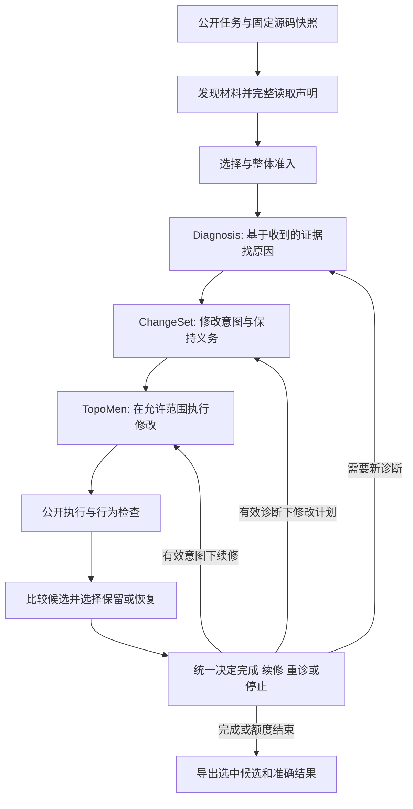

# 原十一项问题的逐项实施与验收

当前冻结生产摘要：`15141db36fde55f526e18be0b288a24548b0a91a6c5ce40b7763603aaa4636f4`。下表区分确定代码缺陷、策略验证和设计边界；不把所有失败归为一种“上下文不足”。所有项共用最终工程验证，真实成绩以状态与最终对照报告为准。

| 原问题 | 当前具体修改／保留行为 | 主要文件（均在src/contractedge） | 怎样判断有效／当前边界 |
|---|---|---|---|
| 1 首次函数不完整 | 初选和补证选择前共用完整声明读取；快照、行号、parser、声明身份绑定，新正文产生新ID，已采用正文不换体。显式窗口仍标为窗口。 | source/units.py；orchestration/runner.py | 长于80行或16000字符的函数尾部进入最终请求；CRLF、同名receiver、artifact同路径及快照变化反例通过。全文放不下须明确停止。 |
| 2 关键函数／依赖没有找到 | 保留基线已有Go跨文件与依赖读取，不重新更改排序。 | source/go_context.py、source/dependency.py、retrieval/gap_delivery.py（保留）；runner.py（接完整声明） | 新候选材料管道中KPT四段函数和Helm三条API均找到、选中且完整进入准备请求；这不证明模型采用或整案修复。 |
| 3 容量各自提前阻断 | 保留不同维度的必要限制并记录真实触发量；单独使用同一新源码比较原容量与四项联合扩容。 | model/budget.py、orchestration/runner.py；实验配置 | 工程边界通过；真实扩容组必须显示具体停止解除及收益，不能由“放入更多文本”判优。默认配置尚未因实验而改写。 |
| 4 数量限制口径不一 | 初选数与初次采用数共用冻结top_n；补证继续复用原有累计额度。 | diagnosis/evidence.py、runner.py、retrieval/candidates.py | top_n=16的初选准入反例通过；保持每次补证12条／24000字节及最多两次，不无依据一起放开。 |
| 5 同名线索成为强制材料 | 同时取消runner的纯词法required注入，收窄候选共同角色判断；显式端点、anchor和真实混合角色仍保留。 | runner.py、retrieval/candidates.py | 两条错误路径的正反例均通过；送达的源码约束仍由ChangeSet审查适用性，不自动忽略。 |
| 6 诊断输出与纠错重叠 | 空白定位提示进入原有格式纠错；校验、引用与共享纠错额度保留，不对非法关系自动拆解或放行。 | contracts/schema/diagnosis_packet.v1_1.json、semantic_changeset.v1_1.json；runner.py | 空搜索不再耗取材机会；非法输出仍有界停止；因果真实性与共享额度回归通过。是否增加纠错次数尚无依据，本轮未增加。 |
| 7 新建helper被当成找不到旧实现 | 保留已有EXPECTED_MISSING、新增helper与实际缺失搜索路径；无禁止新建的事实，不加案例规则。 | contracts/validation.py、diagnosis/prompt.py、runner.py（现有能力） | 既有合法新增与非法伪证据回归通过。模型仍可能误判，要从新真实回复定位；不能把这项标成“已保证模型不再误判”。 |
| 8 容量／交付失败混淆 | 交付未完成统一终态；错误记录包含维度、实际值、上限和原始错误，请求容量与执行支持容量分开。 | contracts/failures.py、model/budget.py、runner.py | 记录反例、全链投影及完整回归通过。与语义上的EVIDENCE_GAP区分，未新建账本。 |
| 9 异常漏检索轮次 | 全部返回共用同一检索轮次记录出口，不再逐分支补写。 | orchestration/runner.py | 主动失败、异常、补证后失败均保留已发生轮次；与证据正文丢失区分。 |
| 10 控制重复／候选退步 | 实际benchmark启用已有候选比较与恢复；公共注册检查和有效保持义务组成保护集合；统一反馈与下一动作入口，前提只关联自己的检查，仍保留快照新鲜度。 | execution/public.py；orchestration/repair.py、feedback.py、transitions.py | 两轮真实控制循环fixture验证候选恢复、允许目标变化、相关与无关前提、UNKNOWN未完成不能关单；next-action与实际派发一致。任务没有注册固定检查时依旧依靠有效保持义务，不冒称拥有全案检查集。 |
| 11 TopoMen自主能力有限 | 本轮不扩大权限；仍是有界编辑，后续续修由ContractEdge控制。 | execution/topomen_agent.py、execution/consumers/topomen.py（保留边界） | 待真实面板确认共同瓶颈发生在执行后，再注册同预算的有限搜索／读源码／编译实验；不是这四个工作包的强制新增机制。 |

## 三个核心组件的实际分工

模型不负责维护摘要ID、账本或统计标签。已经采用且仍需使用的正文完整传递，完全相同的副本可以去重；新材料在整体准入后使用。发现、选择、准备传输、模型实际采用及行为修复是不同事实，分别核验。

## 协作时怎样继续

从冻结候选标签新建分支；先写明所改问题编号、旧反例、要保留的保护和验收条件。分包修复记录见PACKAGE_1至PACKAGE_3；已冻结真实面板不修改代码、配置或旧失败结果。独立评分失败不自动等于数据集有问题，也不自动等于某一个核心组件有缺陷。由真实阻断阶段决定下一处修改，先走既有共同入口，避免新增案例特判和重复流程。
