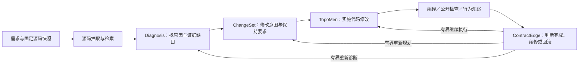

**ContractEdge 当前组件、已知问题与优化计划（2026-11-04）**

结论：部分规则需要收窄，取材与容量需要分别处理；诊断纠错的命名和记录须反映实际共享范围，是否按每轮扩大纠错额度仍待独立验证。当前证据支持修正核心组件之间的输入和控制边界，没有证据要求推翻 Diagnosis → ChangeSet → TopoMen。确定性代码缺陷有明确修法；模型能否利用改善后的输入提高修复率，仍须真实对照。

这是目前已知问题的汇总，不代表已排除整个系统的所有未知缺陷。本轮为解释性复核：没有修改业务源码、运行新测试或调用模型。下列源码链接统一指向最新冻结候选 e6784；不要将候选代码视为已经安装。

**1. 版本与效果证据必须分开**

| 对象 | 当前状态 |
|---|---|
| 已安装 `/home/xhj/contractedge-system`，063d12e | 保留不变；不是最新候选。 |
| 已完成真实对照的 806e29f | 固定八案例：候选 3/8、对照 2/8；两例改善、一例退步，一例共同通过。样本小，尚不能证明稳定整体收益。 |
| 最新候选 e6784c1 | 取材及新增依赖准入修复已完成同源工程核验；尚未安装，尚无新的真实模型整案成绩。 |

e6784 的 portable 完整运行实际为 3347 通过、7 失败、4 跳过；7 个失败来自资格验证临时路径过长，原节点在短路径精确重跑全部通过。共 3354 个不同普通测试通过，另有 90 个 subtest；不能写成一次全量全绿。Native 9 项、六分支模拟通过。六个历史/native 模块未包含在 portable 范围；模拟使用固定回复，不是六个真实模型案例成功。

**2. 三个核心组件与外围代码的关系**

材料保存、请求准入、预算、记录和状态投影为整条流程提供共同支撑，不是第四个模型推理核心。

| 部分 | 主要文件，均相对候选 `src/contractedge/` | 实际责任 |
|---|---|---|
| Diagnosis 核心 | `diagnosis/prompt.py`、`parse.py`、`validate.py`、`operation_consistency.py`；`contracts/validation.py` | 模型提出原因、关系和缺口；程序验证结构、引用和一致性。 |
| ChangeSet 核心 | `changeset/prompt.py`、`validate.py`、`state_mapping.py`、`adapter.py`、`topomen.py` | 说明怎么改、哪些行为必须保持、有哪些未解决义务，并转换为执行计划。 |
| TopoMen 核心及适配 | `execution/topomen_agent.py`、`execution/topomen.py`、`execution/consumers/topomen.py`；候选根目录下 `vendor/topomen/src/topomen/collaboration/base_agent.py` | TopoMen 生成实际编辑；ContractEdge 适配层提供材料、约束编辑范围、应用修改。 |
| 共用取材 | `source/units.py`、`parsers.py`、`go_context.py`、`dependency.py`；`retrieval/candidates.py`、`gap_delivery.py` | 从真实快照找声明、调用者、依赖 API，决定新候选是否进入请求。 |
| 共用证据 | `diagnosis/evidence.py`、`orchestration/semantic_delivery.py` | 同一份材料的身份、正文、采用与实际送达。`evidence.py` 虽放在 diagnosis 目录，实际服务跨阶段交接。 |
| 流程控制 | `orchestration/runner.py`、`repair.py`、`transitions.py`、`state.py` | 调用、纠错、补证、阶段跳转、续修和回滚。已有统一转移入口，不能说完全没有合并。 |
| 请求与费用 | `tokenizers.py`、`model/admission.py`、`budget.py`、`provider.py` | 单请求容量、总预算、实际发送和可信用量结算。 |
| 检查、运行与评价 | `execution/public.py`、`review.py`、`runtime_session.py`；`contracts/status.py`；`evaluation/gt_adapter.py` | 保存真实运行观察；区分执行状态与语义结果；独立评分不向方法泄露隐藏评价材料。 |

因此，“修 runner 或 retrieval”会影响核心组件的效果，但不等于重写核心创新；“文件在 diagnosis 目录”也不等于它只是诊断提示词。

**3. 当前已知问题：具体位置、状态、最小改法**

| 问题 | 位置与所属层 | 已有证据／状态 | 对症措施及验收 |
|---|---|---|---|
| ① 第一次抽取的函数可能已经不完整 | [source/units.py:13](/home/xhj/contractedge-reports/system-core-consolidation-20261104/followup/source-access-admission-fix/system/src/contractedge/source/units.py:13)、[source/parsers.py:281](/home/xhj/contractedge-reports/system-core-consolidation-20261104/followup/source-access-admission-fix/system/src/contractedge/source/parsers.py:281)；runner:1773。共用取材，首先影响 Diagnosis。 | 默认 80 行、16000 字符；后面完整保存摘录不等于恢复函数尾部。Helm 的 118 行函数在 256 行设置下完整，只多 1138 字节；约 20KB 函数仍会被字符限额截断。**未完成完整声明策略修改。** | 先单独验证已有 `max_lines_per_unit`，不要与纯容量实验混合。关键声明若仍截断，在首次采用前按真实声明范围整体读取、重新绑定身份并整体准入；不能原地改写已经采用的旧 ID 正文。验收函数尾部、坐标、内容摘要和下游实际请求一致。 |
| ② 找不到关键本地函数或依赖声明 | `source/go_context.py`、`source/units.py`、[source/dependency.py:281](/home/xhj/contractedge-reports/system-core-consolidation-20261104/followup/source-access-admission-fix/system/src/contractedge/source/dependency.py:281)、`retrieval/gap_delivery.py`。共用取材。 | 旧 KPT4746 缺四段关键声明，共 2716 字节，根本没有入池；旧 Helm 诊断没有共用依赖读取入口。**e6784 已修且回放送达；真实模型收益待验证。** | 复用同快照的接收者、构造器、调用者定位和固定版本公共依赖读取；不加案例规则。保留原初选排序。验收从发现、入池、选中到最终请求的完整链。 |
| ③ 多层容量彼此独立，扩大模型窗口不一定有效 | [tokenizers.py:8](/home/xhj/contractedge-reports/system-core-consolidation-20261104/followup/source-access-admission-fix/system/src/contractedge/tokenizers.py:8)、`model/admission.py:67`、[runner.py:1348](/home/xhj/contractedge-reports/system-core-consolidation-20261104/followup/source-access-admission-fix/system/src/contractedge/orchestration/runner.py:1348)、`:1424`。共用准入。 | 本地计数为 UTF-8 字节上界，非实际模型 tokenizer。Cert 最终草案支持材料 **100826 > 100000 字节**；9 条前置条件并未达到 12 条限制。仅增请求窗口仍失败；支持额度 200000 原样通过。**配置实验待运行。** | 同 e6784、同八案例、同其他限制，对比原配置与请求/支持配套扩容。记录具体哪道门槛解除及后续实际行为。不能把准入通过当作修复成功。 |
| ④ 初选、补证、支持名额存在分散上限 | `diagnosis/evidence.py:23,107`、`retrieval/candidates.py:316,840`。共用源码管理。 | 初始 canonical 12 条；每次补证 12 条/24000 字节，两次累计 24 条/48000 字节；初始候选池另有 80 条默认。**约束已确认，不代表每条都造成当前失败。** | 不单改 top_n 到 24，也不一律放开。先看哪层实际拒绝关键端点；需要调时由共同配置传到生产、选择和采用边界。当前容量面板不改变这些变量。 |
| ⑤ 普通词法提示被提升为必须送达条件 | [diagnosis/evidence.py:385](/home/xhj/contractedge-reports/system-core-consolidation-20261104/followup/source-access-admission-fix/system/src/contractedge/diagnosis/evidence.py:385)、[runner.py:1370](/home/xhj/contractedge-reports/system-core-consolidation-20261104/followup/source-access-admission-fix/system/src/contractedge/orchestration/runner.py:1370)、[retrieval/candidates.py:125](/home/xhj/contractedge-reports/system-core-consolidation-20261104/followup/source-access-admission-fix/system/src/contractedge/retrieval/candidates.py:125)。Diagnosis 输入及控制边界。 | `solver` 命中新候选字段与注释，就进入 required IDs 与 SOURCE_CONTRACT 角色两条强制路径。匹配没有证明该类型在故障路径中。**机制确认；收窄方案未实现。** | 同时取消纯词法提示的这两条自动强制路径；新候选按正常相关性和容量竞争。显式 required、真实 anchor、混合真实必需角色、所有已采用正文继续保护。保留已交付注释的 ChangeSet 适用性审查；不自动判无关。 |
| ⑥ 诊断关系输出不合法，纠错范围与名称不一致 | [contracts/validation.py:356](/home/xhj/contractedge-reports/system-core-consolidation-20261104/followup/source-access-admission-fix/system/src/contractedge/contracts/validation.py:356)、`diagnosis/prompt.py:27`、[runner.py:1620](/home/xhj/contractedge-reports/system-core-consolidation-20261104/followup/source-access-admission-fix/system/src/contractedge/orchestration/runner.py:1620)、`:1653`。Diagnosis 协议与编排。 | KPT4673 所需函数已送达，却输出不合法的多端点 DIRECT_EDGE；两轮扩展实际共用一次纠错，名称却容易被理解为每个新上下文一次。**模型错误与策略边界并存。** | 先使 scope、剩余次数、具体校验错误记录一致；再独立试验“真正新增并送达的补证轮次各一次有界纠错”，仍受总调用/费用约束。不自动拆关系、补因果解释或放行假正确结果。 |
| ⑦ 缺口判断可能是模型理解问题 | `diagnosis/prompt.py`、`contracts/validation.py:448`、`runner.py:1006`。Diagnosis 核心。 | CloudWatch 入口已送达；系统本来允许有依据地新增 helper，模型却继续寻找旧实现并遗漏关系。**不能当作禁止新建函数的代码缺陷，也没有证明材料完全充分。** | 针对实际新回复核查“现有实现不可见”与“需要新增实现”判断、生产路径和编辑权限。仅当发现错误限制再改校验；不为该 case 放宽真实性或自动 READY。 |
| ⑧ 不同停止原因的记录仍混在一起 | [runner.py:1438](/home/xhj/contractedge-reports/system-core-consolidation-20261104/followup/source-access-admission-fix/system/src/contractedge/orchestration/runner.py:1438)、`retrieval/candidates.py:393`。共用审计。 | 支持容量、前置条件等 BudgetExceeded 会走同一裁剪分支，被记作 FULL_REQUEST_CONTEXT_BUNDLE。**已确认信息缺口，未修。** | 在已有审计字段保留实际门槛、测量值、限额、原始异常；不新增模型字段或数据集标签。先能准确说出为什么停，才能比较优化是否有效。 |
| ⑨ 异常返回漏带检索轮次 | [runner.py:2122](/home/xhj/contractedge-reports/system-core-consolidation-20261104/followup/source-access-admission-fix/system/src/contractedge/orchestration/runner.py:2122)。共用记录。 | Helm 控制回放有三次调用、两次补查，但异常兼容 trace 的 retrieval_rounds 为空。**已确认，未修；不是正文丢失。** | 在进入 try 前初始化轮次容器，异常返回沿用已有字段保存已发生事实，兼容早期异常。不得重新造一份账本。这是审计修复，不单独宣称提高修复率。 |
| ⑩ 编排仍集中，部分责任重复 | `orchestration/runner.py`、`repair.py`、`transitions.py`、`state.py`。流程层。 | 前半程和修复主函数仍分别约 1075/975 行；已存在状态转移与共同预算入口。**维护风险，不是单凭长度就确认的效果缺陷。** | 在行为边界稳定后，将同类拟合/校验/派发投影复用已有入口，删除重复计算；不先整套重写，也不为每种失败增加独立模块。等价回放、状态与预算行为不变才接受整理。 |
| ⑪ TopoMen 单步、无 shell；部分恢复不支持 | [execution/topomen_agent.py:153](/home/xhj/contractedge-reports/system-core-consolidation-20261104/followup/source-access-admission-fix/system/src/contractedge/execution/topomen_agent.py:153)、`:169,194`；[execution/consumers/topomen.py:85](/home/xhj/contractedge-reports/system-core-consolidation-20261104/followup/source-access-admission-fix/system/src/contractedge/execution/consumers/topomen.py:85)。核心执行器适配。 | 单次受限编辑，外层控制续修；native 已收到响应后的自动恢复明确不支持。**当前设计边界，尚非已证明主要瓶颈。** | 独立试验有限搜索、只读源码、受控编译与续修，共用总预算和编辑边界。先查能复用哪些外层能力；不无限搜索/命令/重试，不因未知响应自动重发。 |

⑤要改的是“相似词自动产生必需性”；不是取消反证或源码真实性。ChangeSet 已能判断 REQUIRED、UNRESOLVED、NOT_APPLICABLE。`changeset/prompt.py:171`、`changeset/validate.py:80,174`、`runner.py:811`、`repair.py:286` 的精确引用、适用性审查及 READY 重算应保留。不相关的已交付材料可以明确解释不适用，不能由程序替模型自动作语义结论。

Certmanager 的直接停止原因是支持容量，不是已经证明 Solver 无关。去掉词法强制化是有依据的通用简化，但不能预告删除这一条件就能修好该 case。

**4. 旧问题哪些已经落实到代码**

以下已核对最新候选实际代码；不能反复把它们列为新发现、尚未处理的主要缺陷。

| 历史问题 | 当前处理与位置 |
|---|---|
| 需求、已采用／引用正文在后续交接丢失 | `orchestration/semantic_delivery.py`、`diagnosis/evidence.py` 保留正文与身份，检查实际派发。初次抽取不完整仍是另一个问题。 |
| 自然语言关键词强迫生成三态说明 | `changeset/state_mapping.py:12` 已改为可选解释，原需求覆盖校验仍在。不同于本报告尚未修的源码词法必需性。 |
| 补证重新排序挤掉已经采用的材料 | `retrieval/candidates.py:727,790,825` 的追加与保留规则已处理；未发送候选仍可竞争。不能由此推断排序一定最优。 |
| 新依赖占走必需本地端点名额，或令可行请求整体失败 | `retrieval/candidates.py:770,844`、`runner.py:1548,1589` 优先保留本地必需端点；必要时只撤回未发送可选 API，再复用原本地拟合一次。已采用 API 不删除。 |
| 原文件行号用于拼接后的展示窗口，helper 被切空 | `execution/topomen.py:456,605`、`helper_context.py:271,319` 使用原文件全文查找；展示窗口与查找源分开。 |
| 全部 batch 异常变成 INTERRUPTED | `orchestration/batch.py:149`、`contracts/failures.py:97` 统一按实际原因分类。 |
| 非法 public review 与正常观察不足混成 UNKNOWN | `execution/review.py:170,182,201,224` 校验与有界纠错；`repair.py:1171` 保存明确 model_format 失败。观察不足仍可以合法 UNKNOWN。 |
| 执行完成混同语义成功 | `contracts/status.py:26,63` 分开投影；`evaluation/gt_adapter.py:175` 独立判断评分资格。真实已执行候选可独立评分不等于公开检查已通过。 |
| cleanup 覆盖原进程失败 | `execution/runtime_session.py:570,610,627,695` 分别保留主失败与清理结果。 |
| HTTP 前未发送被记成响应未知 | `model/provider.py:320`、`model/budget.py:228` 使用实际边界事实；进入发送后的未知情况不伪装成未发送。 |
| 恢复成功产物绑定旧失败调用 | `orchestration/recorder.py:77,89,508,531`、`runner.py:1335` 绑定真实响应及其产物。 |
| 预留用量不释放 | 可信结算已经启用并生效；Helm 三次总预留 520510，结算 166426，释放 354084。不要再次提出“开启结算”作为未完成措施，也不要据此放松单次容量边界。 |

**5. 为什么感觉问题一直在变，是否修不好**

相同 EVIDENCE_GAP 或提前停止可以来自不同环节：没发现、最初摘录不完整、放不下、新材料被误判为必需、模型仍判断证据不足。旧记录还曾把多种门槛混在一起，放大了这种不清楚。原问题修好后，后一道独立阻断才会显现；也确实存在修复引入回退的情况，所以必须保留失败历史和固定对照。

目前可以明确定位并修正代码行为，但不能保证每个 case 修复成功。806e 八案例中五例未进入执行；三例进入执行且通过独立检查，只说明本小面板的主要损失发生在前半程，不能据此宣布执行器最优。KPT4673 在对照中通过，不能把候选失败简单解释为案例本来无解。保留 Dapr 等难例，不把任何单例必须通过当作目标。

**6. 明确的执行顺序与完成判据**

1. **建立一个可核对的问题清单。** 本报告完成组件映射；⑧⑨及⑥的记录口径可在独立后续分支并行修复，复用已有字段与容器，不增加模型协议，也不改写已冻结实验源码。这些修改帮助归因，不作为冻结 e6784 既定效果验证的额外前置条件，也不作为修复率提升成绩；冻结实验可继续使用已有独立记录核对实际门槛。
2. **验证已经完成的取材修复与容量组合。** e6784 两组同源码、同固定八案例、共 16 槽；只变四个配置字段：总请求 220000→440000、初诊 120000→240000、model_context 262144→1000000、支持正文 100000→200000 字节。测试的是组合容量收益，不单独归给任一参数，也不能用与旧源码的历史差异证明纯代码收益。保留完整交付检查。若仍需量化取材代码本身收益，另在同配置下比较 806e 与 e6784。
3. **针对剩余机制分别做最小修改。** ⑤仅改 runner 与 candidates 两条自动强制路径；①独立调整提取行数并必要时实现首次采用前完整声明；⑥纠错政策仅对实际新增上下文做有界实验。每项有针对性验收，再看固定面板收益与退步，不能同时改完后猜哪个有效。
4. **再做控制代码合并和 TopoMen 自主查阅实验。** 复用现有材料、预算、运行与状态入口；保持 Diagnosis 判断原因、ChangeSet 管修改与保持要求、TopoMen 执行的分工。只有进入执行后的真实失败表明需要自主查阅，才将该能力作为后续重点。

每项优化至少回答：原触发条件是否仍能复现；同条件下是否解除；原已采用内容和真实约束是否保留；更多案例是否受益且没有不可接受退步；调用/费用/时间是否仍可控。不以测试数、请求文本变大或“到达更后阶段”替代最终行为效果。

容量面板已完成登记草案和 17 项派发绑定测试，仍为禁用：完整 controller 检查、独立审查及根代理技术放行尚未完成。本次解释性复核不启动付费派发。累计费用授权仍为既有 ¥100，无需重复申请；最后核实占用 ¥68.173610，历史未结算预约保留。

当前 **formal_ready=false**。进入正式实验的依据应是固定版本、完整材料与可解释停止原因，以及真实固定面板显示可接受且可复现的整体效果；不是 150/150，也不是只让某个难例通过。

**7. 主要证据**

- [分层容量与实际用量](/home/xhj/contractedge-reports/system-core-consolidation-20261104/analysis/SOURCE_ACCESS_CAPACITY_LAYER_REVIEW.md)
- [原五个失败案例的分析](/home/xhj/contractedge-reports/system-core-consolidation-20261104/analysis/ROUTING806E_FIVE_FAILURE_CAPACITY_MATRIX.md)，其中 Cert 直接门槛以[后续实测校正](/home/xhj/contractedge-reports/system-core-consolidation-20261104/analysis/ROUTING806E_CERTMANAGER_GUARD_CORRECTION_AND_COUNTERFACTUAL.md)为准。
- [初次抽取与词法必需性设计审查](/home/xhj/contractedge-reports/system-core-consolidation-20261104/analysis/SOURCE_EXTRACTION_LEXICAL_REQUIREMENT_DESIGN_REVIEW.md)
- [同源码 KPT 容量反事实](/home/xhj/contractedge-reports/system-core-consolidation-20261104/analysis/SOURCE_ACCESS_CAPACITY_COUNTERFACTUAL.md)
- [最新候选工程证书](/home/xhj/contractedge-reports/system-core-consolidation-20261104/followup/source-access-admission-fix/ENGINEERING_VERIFICATION.json)与[独立复核](/home/xhj/contractedge-reports/system-core-consolidation-20261104/analysis/SOURCE_ACCESS_FINAL_CERTIFICATE_INDEPENDENT_REVIEW.json)
- [已完成 806e 真实面板独立复核](/home/xhj/contractedge-reports/system-core-consolidation-20261104/analysis/BOUNDED_CONTINUATION_PANEL_RESULTS_INDEPENDENT_AUDIT.json)
- [容量面板准备回执，派发仍关闭](/home/xhj/contractedge-reports/system-core-consolidation-20261104/followup/context-capacity-real-panel-draft/PREPARATION_RECEIPT.json)
