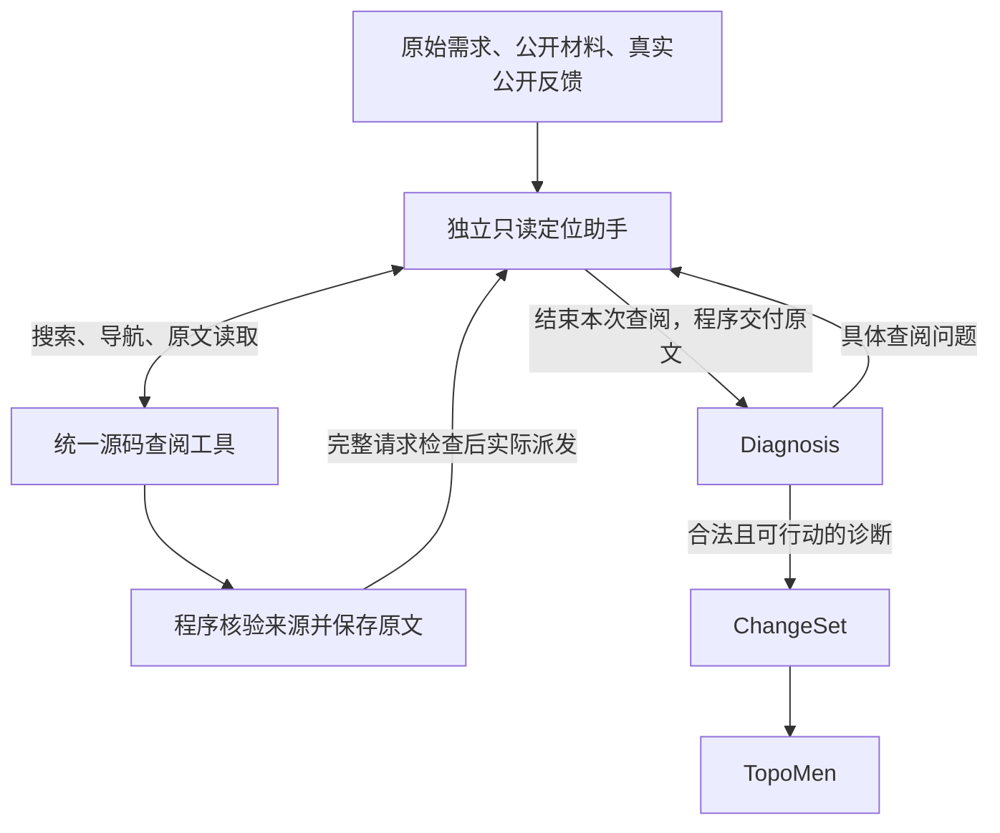

# ContractEdge 前半程重构：设计、代码修改与验收规格

日期：2026-11-05。面向负责代码实施、评审和实验的协作者。

**状态：设计已明确，生产代码尚未实施本方案，真实模型收益尚未验证，`formal_ready=false`。** 本次发布的是实施规格，不能将文档提交当作新算法版本或实验完成。

目标是让系统从公开任务自主找到必要源码，完整交给 Diagnosis，形成有依据、可交给 ChangeSet 的诊断。保留 **Diagnosis 找原因 → ChangeSet 表达修改与保持要求 → TopoMen 修改代码**。增加一个只读定位助手，替代旧的多级候选淘汰和独立补证准入流程。

## 1. 版本、范围与文档优先级

| 项目 | 固定起点 |
|---|---|
| 仓库 | [xuhhhhjie-pixel/contractedge](https://github.com/xuhhhhjie-pixel/contractedge) |
| 协作分支／PR | `fix/four-step-consolidation-20261104`／[草稿 PR #33](https://github.com/xuhhhhjie-pixel/contractedge/pull/33) |
| 当前包版本 | `0.6.68`，不能单独作为实验身份 |
| 基线生产源码 SHA-256 | `15141db36fde55f526e18be0b288a24548b0a91a6c5ce40b7763603aaa4636f4`，123个生产文件 |
| 冻结标签 | `system-15141-fourstep-candidate-20261104` |
| 标签实际提交 | `d842853a9ef0d729c2a965a6481c229fbb04b0fb` |
| 文档发布前协作分支提交 | `73e9a3bbdcff418ee042bb67a6eee09a8d557880`；本规格后续文档提交以 Git 历史为准 |
| 服务器安装副本 | 仍是源码 `063d12e2…`，不是本次实施起点；不原地修改安装副本 |

本规格是**后继版本前半程工作的当前依据**。20261104目录保留历史事实、代码结果和失败记录，但其中“保留40条候选”“仅统一24k/48k补证配置”“必须逐项做机制消融”等后继建议，不再约束本方案。不能以更新建议为理由改写旧运行、旧失败、旧标签或费用记录。

本方案可以将定位模型、结构化读取、交付简化、Diagnosis接口修复作为一个整合候选实现，然后比较整体效果。代码仍须分批评审、有反例和明确验收；这不等于要求每个函数改动单独付费做模型实验。

范围包括前半程及其必要交接适配。TopoMen无限自主执行、ChangeSet全部语义策略、后半程候选保护重写，不属于本轮设计。前半程交付的正文必须能够继续通过 ChangeSet 和 TopoMen 的真实请求边界，因此下游重复源码额度的适配属于本轮。

## 2. 为什么需要这次重构

历史32槽、142次模型调用已完成。同容量12案例对照中新旧版均为4/12通过，新增1例成功、退步1例，新版调用由49增至57，费用由7.028560增至7.896752元。新版同容量12案中7案在编辑前停止。工程检查通过没有证明整体效果提高。

| 已知问题 | 可核查事实 | 本方案的直接改法 |
|---|---|---|
| 找到了但永久出局 | Certmanager点名函数排48，候选池保留40；函数约582字节 | 精确声明可直接读取；导航结果分页继续访问，不先争抢40个位置 |
| 全文被内部额度拒绝 | Prometheus完整`main`为1282行、52679字节；超过单次24000／累计48000，第二次请求未发送 | 撤去独立补证条数／字节门及重复阶段门，在真实请求边界检查容量 |
| 搜索没有回答问题 | CloudWatch同时给函数和操作词，函数名覆盖了操作查询 | “在哪里看”与“查什么”分别保留，返回对应范围的搜索事实 |
| 依赖入口过窄、读取不全 | Helm部分查询需猜中未知API；旧提取器跳过Go receiver方法 | 沿真实导入、调用对象及固定版本依赖读取构造、方法和分支 |
| 已送材料用途不一致 | Helm一组已收到3条只读API，仍索要相关信息 | 输入用途、正文位置、允许引用方式与实际校验统一；不能断定说明缺口是唯一原因 |
| 纠错指向程序内部字段 | 模型输出需求的`disposition`，反馈却要求改内部`outcome_coverage`字段 | 保留原始模型视图，将校验错误映射回模型字段；派生关联由程序维护 |
| 材料已齐仍反复补查 | KOPF历史3次实际请求都包含4个相关完整函数，仍索要未来修复成功观察 | 查阅与完整诊断分离；保留因果校验，减少重复协议负担，真实验证模型判断 |
| 独立次数上限提前终止 | Helm三次诊断、两次补查、零编辑，最终补证次数耗尽 | 新查询受统一任务预算控制，相同查询复用，无进展有界停止 |

这不是统一归因于“窗口小”。还包括查错方向、漏掉消费者、内部关卡拒绝、接口矛盾和模型推理错误。

20261105的公开源码／历史请求离线检查补充了以下事实：

- Helm：结构读取可定位旧提取器缺少的9个依赖方法；但研究查询由分析后指定，不是新助手自主定位成绩。
- Certmanager：直接查询读到目标声明；两个相同receiver文本的`changeRecord`仍需包和文件身份区分。568个生产Go文件中13个在所用tree-sitter-go 0.25.0下产生解析错误，涉及Go 1.26表达式形式的`new`。应有原文或匹配语言版本解析器后备；不能认定案例源码非法。
- CloudWatch：固定`metric_alarm`包9个生产文件内没有三个目标标签API的精确调用，但另一个文件确有标签差异计算。局部零命中不等于系统没有相关逻辑。
- Prometheus：完整声明重建与历史摘要一致；全文读取成功不会自动解除旧准入门。公开反馈仅构建完成，不能编造运行恢复观察。
- KOPF：4个Python函数共4503字节，历史已经完整送达，说明只改定位不足以关闭所有诊断问题。

这些检查没有新增模型调用，没有修改生产代码，没有证明5案整案修复通过。历史失败与回放入口见第14节。

## 3. 五点设计与职责

### 3.1 主流程



统一请求、费用和记录入口贯穿定位、Diagnosis及后续阶段。图中的“结束查阅”不是READY或修复成功；是否形成合法、可行动诊断仍由Diagnosis及既有校验决定。

| 五点 | 负责什么 | 不增加什么 |
|---|---|---|
| ① 独立定位助手上下文 | 根据需求和工具结果决定下一步查哪里；首次定位和后续补查共用 | 第二份Diagnosis、独立修复代理、另一套费用账本 |
| ② 统一源码查阅工具 | 定位、全文读取、固定依赖追踪、明确范围的操作查询 | 案例特判、只支持某一种配置链的强制关系表 |
| ③ 程序保证原文交付 | 来源、坐标、正文、引用与实际请求一致；采用后完整交接 | 模型自己抄源码、摘要替正文、多份互不一致的证据库 |
| ④ Diagnosis专注原因 | 解释预期、实际实现、违反关系、因果依据和真实未知 | 让模型维护程序派生数组、用自动READY掩盖错误诊断 |
| ⑤ 统一预算与停止 | 真实请求容量、输出留量、任务费用／时间／调用、无进展停止 | 独立两次补证门、叠加的条数和字节准入 |

### 3.2 定位助手的输入、权限和输出

输入来自原始公开需求、允许的声明材料、当前快照、当前真实公开反馈、Diagnosis的具体问题以及本次查阅进度。原任务本来提供的路径或函数名可以使用；不得另行注入研究者分析出的目标名单作为“自主定位”的前提。

定位助手可以使用与其他阶段相同的DeepSeek底层模型、独立会话。独立指职责和上下文，不要求再采购不同模型。具体provider型号、配置及工具协议须在真实验证前冻结。

真实验证沿用用户指定的DeepSeek官网v4-flash；派发前核对接口可用型号，登记实际请求和响应中的模型标识，不擅自替换模型。API密钥由运行环境提供，不写入本规格、Git或模型上下文。

定位会话保存查阅问题、进度和已读原文，不复制完整Diagnosis输出schema或要求先填关系图。程序可以重建导航进度，但不能用导航摘要替换已采用正文。

助手只通过受控工具读取任务允许的仓库、声明材料和固定依赖。不能编辑、运行任意shell、读取隐藏评分或修复答案、选择未绑定的外部依赖。工具失败允许改查法，不能据错误制造不存在事实。

建议新增一个薄模块`retrieval/locator.py`负责循环，工具入口放在`source/navigation.py`。这是拟新增位置，当前尚不存在；实现时如已有等价入口可复用，不应另建服务进程。

模型每次只需表达一个工具动作或结束本次查阅。例如下列是**拟议交互格式**，不是当前已实现schema：

```json
{"action":"search","arguments":{"scope":"pkg/example","symbol":"BuildClient","text":"PlainHTTP"}}
```

```json
{"action":"read","arguments":{"handle":"由工具返回的精确声明句柄"}}
```

```json
{"action":"finish","open_questions":["仍需确认调用者是否复用已有对象"]}
```

搜索句柄、材料身份、正文摘要由程序生成。`finish`不能提交一份摘要来替代源码，也不能删除已经交付给助手的正文。所有实际读取并交付的材料由程序打包，模型不负责重新抄写或自行宣称“发送完成”。

初始候选为空也必须可以从需求、目录和公开反馈启动助手。禁止继续以`candidate_set.selected_ids`非空作为新路径前提。

## 4. 统一查阅工具的实现契约

下列是能力接口，具体Python类型可复用当前模型；不要求额外建立复杂类型体系。

| 操作 | 输入与行为 | 返回要求 |
|---|---|---|
| `search` | 文件／目录范围、符号／类型／receiver、操作词、可选分页游标 | 路径、声明名称、精确位置、可读句柄、下一页及实际搜索范围／完成情况 |
| `read` | 句柄或消歧后的路径和声明；必要时明确文件范围 | 原文、来源版本、坐标、摘要、是否完整声明；大函数不按80行或16000字符截成全文 |
| `follow_dependency` | 本项目真实导入／调用点、对象或已读声明 | 固定依赖版本中的相关入口、方法、参数类型或导航项；可以再调用`read` |

实施要求：

1. 导航可以只展示名称和位置，避免一开始读入整个仓库。分页只影响展示，不永久删除后续命中。已明确且唯一的声明可直接读，不与文档、注释争抢固定名额。
2. `scope`/`symbol`是定位条件，`text`是要检查的操作内容；同时提供时必须保留两者。只找到函数不等于回答函数是否执行该操作。
3. 同名消歧至少结合来源版本、包／文件、receiver及声明范围；不得仅按名字去重。文本命中只是线索，不自动变成必需端点、因果证据或编辑权限。
4. Go结构解析支持方法、泛型、闭包和正确字节坐标；Python可复用AST，YAML等复用已有解析能力。tree-sitter不能成为唯一读取门。目标节点解析失败时，允许明确范围的原文读取或适合语言版本的后备解析器。
5. 工具必须保留扫描范围、是否完成、解析不足及失败原因。全仓文件多时允许查询指定目录；未完成的搜索可以继续或缩小范围，不能缓存成完整零结果。
6. 固定依赖解析须保留真实import binding、别名遮蔽、版本和来源核验。静态绑定有歧义时返回歧义及候选，不能伪造唯一调用链。不要要求模型先猜出未知API的准确名称才允许进入读取。
7. 查询复用键包含实际查询、范围、游标／完成状态、快照或依赖身份。`G1`等编号不能作为查询等价依据；“找到选项API”与“找到实际消费该选项的方法”不能合并为已回答。
8. 查阅结果在允许的公开范围内产生。只提供构建观察的案例不能被补造运行状态。公开生产代码、声明和允许材料的边界按任务契约处理，不按案例ID前缀推类别。

如引入tree-sitter运行依赖，须同步更新`system/pyproject.toml`及对应依赖锁定文件，冻结解析器／语言grammar版本并验证独立环境安装；不能依赖研究目录临时安装的包。依赖缺失与语法不支持走明确后备路径或报告读取不足，不悄悄返回空索引。

## 5. 一份原文记录及完整交接

### 5.1 复用现有材料记录

以`diagnosis/evidence.py`的`source_context_*`及既有公开观察／声明来源为基础。保留记录中的来源、快照或依赖版本、路径、范围、正文、摘要和实际采用关系；将独立条数／字节准入职责移出。不得新增定位助手专用材料库后再与Diagnosis复制同步。

当前source context版本1的校验将额度与格式绑定。后继实现需要给新契约明确版本或配置身份，保留旧版本读取／拒绝不兼容恢复的边界；不能把旧记录换个版本号就按新规则继续。新旧兼容只用于历史解释，不在同一个新任务里同时运行两套选择流程。

### 5.2 什么时候必须保留全文

- 只浏览路径、名称和声明位置的导航项，不等于已经采用整段源码；此时可以继续精准选择要读什么。
- 工具读取后、尚未发送的正文是准备材料。程序核验其来源，并对下一次完整请求报价；过大时明确拒绝这次派发，不把草案写成已送达。
- 正文一旦实际交付给定位助手，就纳入本次前半程的采用记录，继续完整提供给Diagnosis及相关后续阶段。助手后来声称“不重要”不能成为删除已采用正文的理由。
- 已采用、仍被引用的公开观察、声明和源码同样完整交接。不得只保留ID、摘要或模型转述。
- 同一请求中经来源、版本、范围和正文核对后确认的完全重复副本，可以保留一份正文并解析全部引用。不同文件的相同字符串不能当成同一证据；不得靠删ID前缀猜别名。
- 拼接展示窗口不改变原文件坐标。切片、辅助函数读取和来源验证使用原文件坐标接口；展示窗口只负责展示。

源码改变后，旧版本正文保留其历史身份，不得冒充当前源码。新的重诊链重新绑定当前快照；继承的引用、观察和保持义务仍须有完整历史正文。不得用重启链路来偷偷清空同一次查阅已采用的材料。

### 5.3 可靠交付怎样验收

复用`orchestration/semantic_delivery.py`的检查和实际provider派发回执。检查内容包括：

1. 从固定来源重读相应范围，与记录正文逐字节一致；仅检查正文自己重算的hash不够，截断后重算hash仍须被识别。
2. 序列化后的完整请求包含应交付正文；引用可以解析，来源和版本未改变。同请求无损共享可以，跨请求仅发裸ID不可以。
3. 容量检查、预算预约和实际发送针对同一份准备后的请求；检查后不能重新拼一份不同正文派发。
4. 准备完成、未发送、已派发但响应未知、收到响应分别使用既有真实记录，不将响应未知说成确认收到或使用。
5. ChangeSet与TopoMen真正收到的请求再次核对完整性。前半程放行后，下游不能用旧源码支持字节门再次否决同一份已采用材料。

模型“是否理解／使用”不由文本存在检查证明；它须通过Diagnosis的依据及最终修复结果判断。

## 6. Diagnosis的输入、输出与纠错

### 6.1 查阅请求与完整诊断分开

给Diagnosis的输入包含需求、真实公开反馈、程序整理的材料索引及完整正文，并明确只读依赖可用于理解API，不能充当本项目已经调用该API的证明，也不授予修改依赖的权限。

为模型交互增加轻量查阅响应：只描述当前要解决的问题，以及已知的路径／符号／操作线索。没有线索时可以描述问题，不要求猜中函数名。此响应进入同一个定位助手，不要求先生成一整套原因、关系和覆盖数组。

完整诊断沿用当前`diagnosis_packet.v1_1`的内部语义模型及必要校验；新增的是模型交互入口，不是第二套内部诊断。先用`parse_json_response`区分查阅响应和最终诊断，再决定绑定与校验。合法查阅请求不能使同一回复中的非法最终诊断绕过校验；交互schema须明确两种响应互斥。

具体实现提供独立的薄模型schema：顶层严格仅包含非空`evidence_gaps`数组；每项要求非空`summary`，`locator_hint`可选，存在时至少有一个非空的`path`、`symbol`或`search_term`。查阅记录身份由程序生成；仅有明确问题而暂无定位线索时，由助手决定搜索动作。不能直接套用现有`$defs.evidenceGap`，因为它要求ID和非空定位线索；最终完整诊断的该定义继续保持原要求，不为轻量查阅放松。全为空白的问题仍须纠错。轻量分支不要求先输出atoms、relations、violations或status，不经过`diagnosis_gate()`，不保存为`FINAL_DIAGNOSIS`。

完整模型输出schema实际由`diagnosis/prompt.py::_case_output_schema()`生成，与绑定后的内部JSON schema不同。完整分支先核对本次请求的模型schema，再生成内部对象并做语义校验。`parse_diagnosis_response()`当前不具备轻量协议校验；不能只在提示词中宣布支持。

同步核查`model/output_contract.py`及provider的输出格式适配：实际发送的格式约束必须允许这两种互斥响应，不能本地解析器支持轻量回复、远端请求却仍强制完整诊断全部字段。该边界须通过真实准备请求的工程测试。

### 6.2 保留原始输出，程序负责派生

现有初诊、补证、格式纠错路径都存在“原始body被绑定后的body覆盖”的调用方式。统一抽取解析／绑定／校验入口，明确区分：

- 原始响应文本及解析出的模型输出：供追溯和纠错。
- 内部绑定结果：加入程序生成的身份、来源和覆盖关联，供内部语义校验。
- 校验反馈：映射到当前模型schema中真实可修改的字段，供一次有界纠错。

`_bind_diagnosis_envelope`当前浅拷贝后还会调用`requirement/normalize.py::bind_obligation_sources`，后者可能写入嵌套atom。仅使用两个变量名不够：绑定必须对深拷贝操作，或从保存的原响应重新解析，确保原始模型视图未被改写。

纠错不要求模型修改派生的`outcome_coverage.repair_supported`、`preserve_required`等内部字段。程序应定位受影响的需求、原因及引用，要求修正对应`disposition`或原因判断。一个需求有两个原因、其中一个不受支持时，只指出错误部分，不能删除另一个有效原因。

| 内部错误位置 | 反馈给模型的可修改位置 |
|---|---|
| `outcome_coverage[i].repair_supported / preserve_required / unresolved` | 根据该行`outcome_id`定位`outcome_coverage.O1.disposition`；`O1`仅为示例 |
| `preserve_current_satisfaction[j].status` | 对应需求的`outcome_coverage.O1.preservation_status` |
| 保持证据引用错误 | 对应需求的`outcome_coverage.O1.preservation_evidence_refs` |
| 不受支持的violation | 对应`violations[*].causal_status / support_basis / evidence_refs`及受影响需求的结论 |

改造现有`_format_validation_feedback()`及`_format_validation_feedback_body()`时，显式传入本次模型schema、原始模型对象和内部错误；不能只替换一条文案。继续复用`_translate_model_outcome_coverage()`、`_collect_diagnosis_evidence_ids()`等派生函数。ChangeSet的`_changeset_retry_feedback()`与共享`compact_validation_feedback()`不能为Diagnosis字段转换而被无关地改写。

初诊、补查后诊断、格式纠错和输出截断恢复共用这套处理逻辑，不再按payload形状猜当前属于哪一种方言。保留已有有界纠错，不因特定案例失败增加一套重试计数。

### 6.3 必须保留的语义边界

- 已有静态源码足以支持原因时，可以计划修复；未来修复成功留给执行后验证。
- 需要新增实现与“旧实现尚未找到”不能混为一谈；新增内容仍要有真实依据并进入ChangeSet设计。
- 原程序关键状态确实未知时，保留缺口。KOPF的未来成功观察与Helm Controller的原程序状态观察须成对检验。
- 结果观察不能单独替代因果证据。保留Skaffold的非法因果反例、多端点关系、义务覆盖及错误引用检查。
- 不按关键词自动清空gap，不自动改READY，不以进入下一阶段比例提高代替诊断正确。

## 7. 容量、预算、派发及恢复

### 7.1 新路径删除哪些门

删除前40条永久候选截取、补证12条／24000字节及其累计派生门、独立两次补证上限，以及对已采用正文重复施加的规划helper／执行支持条数或字节门。旧排名可以作为导航提示，不能继续做决定材料能否被读取的隐藏裁判。

具体不能只删`runner`的一条判断：`source_context_offer/validate/restart`、`source_extension_limits`、`extend_once/_append_source_extension`、`PolicyLedger`以及下游请求builder都存在相关约束，必须沿实际新路径一起核查。将限额改成极大数而继续保留整套旧流程，不算完成重构。

### 7.2 保留哪些真实边界

保留每次最终请求的输入限制、模型完整窗口与输出预留，任务整体费用／token／模型调用／时间预算，以及本地工具实际资源保护。所有定位、诊断和纠错调用计入既有同一任务预算和费用账本。

复用`model/admission.py::quote_request/require_context/complete_quoted`和`BudgetedProvider`、`MoneyBudget`。准备后的消息、工具描述、输出schema、必要纠错内容及provider开销均须计入；使用实际provider适配的计数／报价规则，不能把文件字节数当token数，也不承诺本地估算与服务端usage完全相等。

完整请求超窗时，记录输入需求量、输出留量、有效限额、请求身份和未发送事实。可以在读取正文前通过导航缩小查阅范围；不能在采用后悄悄删除正文、裁函数尾部或改发摘要。若已采用材料本身超出真实窗口，按明确原因停止，不能保证任意大仓库都能塞进单次请求。

输入超窗与输出JSON截断分开。后者沿已有有界恢复路径处理，仍保留完整输入和原截断事实，不反写成“输入证据缺失”。

定位动作的半截JSON不能执行为工具调用，最终诊断的半截JSON不能由程序补成有效结论。复用截断识别和有界恢复，并明确纳入定位消费者；不能每进入一轮定位就重新获得一份恢复次数。

### 7.3 新循环怎样停止

有新的具体问题或尚未完成的范围时，在统一预算内继续查阅；相同已完成查询复用结果，范围不完整的结果不能冒充完整缓存命中。是否有进展看新增有效材料／新的查明事实／未完成范围推进，不能只看gap编号或措辞改变。

重复问题没有带来新信息时，明确反馈已有结果，使用现有有界纠错或如实停止；不能无限搜索。新增查阅动作不能逐次消耗旧`evidence_extension`或外层`repair_round/rediagnosis`额度，把原两次上限换个名字带回来。

定位助手不决定整案完成、续修或回滚。原有外层共同路由和候选保护继续负责后半程。局部查阅完成不等于整案语义完成。

### 7.4 派发与恢复的接入细节

`runner.complete_recorded`目前按prompt版本将请求二分为Diagnosis或ChangeSet，并依赖旧`candidate_set`生成材料视图。新助手不能直接套入这一分支，也不能绕过它裸调provider：应显式传入实际消费者和材料视图，复用同一个报价、记录、交付检查、预算及派发入口，支持空初选启动。

`repair.py::validate_ready_trace`及部分校验仍依赖`CandidateSet`。暂需兼容时，只从统一材料记录生成确定性投影，保留原身份、全文和引用；不得调用旧`build_candidate_set/extend_once`重新选择、淘汰或施加`top_n`及字节门。能直接消费材料视图的调用方应移除该依赖。READY恢复核验冻结投影和材料身份，不重新检索选择。

`source_context_commit`对`response_unknown`保守保留可能已经派发的材料；这不是确认对方收到了。不得因网络不确定而自动重发、释放未知费用预约或丢掉相关正文。

新协议／配置身份与源码一起冻结。旧记录按旧契约恢复或明确拒绝不兼容恢复，不使用新规则续跑旧冻结槽；同版恢复不重置预算、不沿用错误快照坐标。现有恢复不支持任意中断点的地方应明确停止，不能在本轮宣称已有全流程任意崩溃恢复。

## 8. 代码修改地图

以下路径相对`system/src/contractedge/`；函数名指当前版本或明确标注的拟新增接口。行号会随实施变化，协作者应按符号定位。

| 修改区域 | 具体修改／复用内容 | 完成后的边界 |
|---|---|---|
| `source/parsers.py`、`source/units.py` | 分离导航与全文；复用`materialize_complete_units`；退出`extract_gap_extension_units`的永久截取；结构解析与原文后备 | 能直接读到精确声明，未完成解析不变成不存在 |
| `source/navigation.py`（拟新增薄入口） | 组合搜索、读取、依赖导航，统一来源与坐标 | 对模型只有一套查阅工具，内部复用已有实现 |
| `source/absence.py::collect_absence_search_evidence`、`retrieval/gap_delivery.py::locate_gap_roles` | 保留定位条件和操作词，范围可继续，区分部分扫描 | 搜索事实回答原问题，无范围越界推断 |
| `source/dependency.py::PublicGoDependencies/_declarations/gap_dependency_support`、`source/go_context.py` | 固定依赖、方法／receiver、真实调用对象、别名遮蔽及歧义 | 不要求未知API精确猜名，不只读取构造入口 |
| `retrieval/locator.py`（拟新增）、`orchestration/runner.py` | 一个只读查阅循环；首次和补查共用；空初选可启动；显式消费者视图 | 退出旧初选／补证淘汰链，不并排跑两个默认流程 |
| `diagnosis/evidence.py::source_context_*`、`retrieval/candidates.py` | 记录保留来源和全文；移除新路径的条数／字节准入；统一身份与去重 | 不重建材料库，旧格式兼容不控制新任务 |
| `diagnosis/prompt.py`、`diagnosis/parse.py`、`diagnosis/validate.py`、`contracts/schema/diagnosis_packet.v1_1.json`、`contracts/validation.py` | 轻量查阅与最终诊断分开；用途说明一致；保留内部语义契约 | 不为查阅生成完整诊断，不放行非法最终诊断 |
| `runner.py::_bind_diagnosis_envelope`及初诊／补查／纠错调用点、`requirement/normalize.py` | 原始模型对象不变；绑定深拷贝；错误统一投影回模型字段 | 不再纠错程序内部数组，无嵌套原地改写 |
| `runner.py::fit_diagnosis/planning_source_draft`、`execution/helper_context.py`、`execution/topomen.py` | 合并材料读取入口；撤去同正文重复源码额度；保留实际请求完整性 | Diagnosis放行的材料不在后续被旧100k等源码门重新拒绝 |
| `orchestration/semantic_delivery.py`、`front_delivery.py`、`recorder.py` | 复用真实准备／派发回执，补齐新消费者及异常查询轮次 | 草案、已派发、响应未知、最终使用分别可追溯 |
| `model/admission.py`、`budget.py`、`money.py`、`orchestration/state.py`、`resume.py`及配置入口 | 一套请求与费用预算；退出旧补证策略消费；新旧运行身份隔离 | 不新增账本，不重置额度，不错误恢复 |

`changeset/topomen.py`、`execution/consumers/topomen.py`及`orchestration/repair.py`的调用方也要跟踪核验材料传递；只有实际接口适配所需时修改，不借本轮重写全部后半程。

## 9. 实施顺序与协作分工

五点是设计职责，下面四批是落地顺序，不是重新恢复20261104旧四步方案。

**第一批：统一工具与来源。** 固定基线，建立上述公开失败的最小反例。实现导航／全文／依赖接口、解析回退、正确范围与坐标。保留旧已修完整声明和词法约束回归；先验证工具，不把定向读取成功计作助手自主成功。

**第二批：材料记录与真实请求边界。** 明确新source context契约；撤去独立数量／字节门，接通完整交付、唯一身份、同请求去重、预算和恢复。一起处理规划及执行支持重复准入，不能只修`evidence.py`后结束。

**第三批：接入定位助手与Diagnosis。** 首次定位和补查走同一个循环；旧候选流程退出新路径。实现轻量查阅协议、原始输出保护、统一绑定／校验／纠错和无进展停止。用真实runner的模拟provider跑完整交接，再检查新模型角色是否每次都通过同一预算与派发入口。

**第四批：集成检查与真实整体对照。** 审查实际diff和调用链，执行针对性检查、现有portable／native／流程模拟，冻结新源码、配置、输入、工具和模型身份，再运行完整案例对照。一次整合验证整体收益，不强制逐机制模型消融。

可并行准备工具、协议和测试，但`runner.py`、`diagnosis/evidence.py`及协议schema需要明确一个集成负责人，避免多人各加一套局部入口。每批提交记录：原问题、反例、修改文件、删除／替代的旧分支、验收结果、保留边界、未完成内容。不能只提交提示词修改或测试数量。

旧路径如需保留用于历史读取或冻结实验，必须有清楚的版本边界；无兼容必要且已无调用的旧分支应删除。不能在默认新路径里同时运行旧候选选择再启动助手。

## 10. 必须通过的工程验收

下表是实施检查项，**本次文档发布不勾选通过**。测试应进入生产接口和真实编排入口，研究脚本通过不能代替接入检查。

| 检查项 | 修改有效的具体标准 |
|---|---|
| 空初选启动 | 无候选正文但有原需求时，实际runner启动查阅；不会先返回`no source candidates resolved` |
| 点名函数与分页 | Certmanager目标不受第48名影响；分页后仍可访问其他结果；同名不同包／receiver不串绑 |
| 定位与操作并存 | CloudWatch原查询得到目标操作在指定范围的结果，不只返回helper存在 |
| 依赖真实路径 | 从实际调用点进入固定依赖，可读取receiver方法；假导入、遮蔽、版本不符不被当作真绑定 |
| 解析失败后备 | 语法不支持仍可读允许范围原文；局部解析成功可用；索引不完整不作全仓不存在结论 |
| 完整声明与坐标 | 超80行／16000字符的函数尾部保留；CRLF、Unicode字节坐标、闭包及拼接窗口不串位 |
| 大声明实际派发 | Prometheus完整52679字节正文通过新路径；真实请求足够时完整发送，不再被24k/48k拒绝；真实超窗时准确未发送 |
| 单份可靠身份 | 错快照、错坐标、截断后重hash、错误digest被识别；同源双ID可一致解析，跨来源相同文本不误合并 |
| 全阶段交付 | 发给定位助手的采用正文进入Diagnosis；被采用／引用正文继续进入ChangeSet和TopoMen，含仅由保持义务引用的观察 |
| 下游无重复关卡 | 初选、补查、规划helper、执行支持、恢复不会再按旧条数／字节额度拒绝同一已采用正文 |
| 原始输出保护 | 绑定与校验后，保存的原始模型对象及其嵌套字段完全不变 |
| 正确纠错字段 | 初诊、补查和纠错均只反馈模型可修改字段；单需求多原因时不误删有效原因 |
| 查阅与诊断分离 | 合法轻量查阅可执行；最终诊断仍检查关系、覆盖、引用与因果；混合非法回复不能绕过 |
| 阶段判断反例 | KOPF未来成功观察与Helm Controller原状态未知分别处理；Skaffold观察不能自动支持因果；不自动READY |
| 请求完整报价 | schema、工具说明、纠错和输出预留计入；报价后消息被改写不能发送；输入超窗与输出截断分别记录 |
| 循环与预算 | 不同具体查询可超过旧两次门；同查询复用；无进展停止；全部模型调用和费用记入原任务 |
| 派发失败与恢复 | 未发送、响应未知、工具异常、非法输出保留真实轮次与原因；未知请求不自动重发；同版恢复不重置预算，跨版恢复明确拒绝 |
| 后半程兼容 | 真实runner经READY交给ChangeSet和TopoMen；CandidateSet兼容投影及同版恢复不重选／重新淘汰；原候选保护、错误分类、回滚和公开状态含义不退步 |

原冻结工程证书的3384项portable通过、9项native及6组模拟仅属于旧候选。后继代码必须重新运行适用检查；`scripts/test_portable.py`的六项历史排除不能为了变绿而扩展，环境缺失与算法失败分别报告。只改本文档时无需重跑整套模型或工程实验。

优先复用已有测试入口：`tests/test_request_admission.py`、`test_budget_settlement_contract.py`、`test_money_admission_boundary.py`、`test_source_context_lifetime.py`、`test_planning_truncation_recovery.py`、`test_planning_recovery_allowances.py`及`test_isolated_recovery.py`。旧条数／字节断言限定于旧协议，新协议另验撤门后的行为；不能删除历史保护测试制造通过。

## 11. 真实验证：评估自主定位与整体修复

### 11.1 输入边界

让新助手从案例原本允许的公开需求、材料、源码和真实反馈开始。原任务自带定位线索可以使用；研究后才知道的函数名单、历史答案、候选补丁、私有评分或隐藏测试实现不能注入助手。工程反例可以有已知目标断言，但这些断言不进入真实模型输入。

实际目标是“模型结合工具自己查到需要的材料”。研究者先指定函数再读成功，只计工具检查。不得混淆这两种成绩，也不要求自动定位一定重现研究者完全相同的查询顺序。

### 11.2 固定整体对照

当前候选`15141db3`作为直接对照，新候选冻结新的源码摘要。沿用已有固定12例作为开发回归面板：Certmanager、Helm Provider、CloudWatch、KOPF、KPT4673、KPT4746、Alertmanager、Helm Controller、Skaffold、Prometheus、RW-CAND-130、RW-CAND-091；正式case_id与输入身份从既有面板文件绑定，不凭简称或前缀猜测。

新旧使用相同底层模型、公开输入契约和公平任务总预算，实际配置完整登记。新版本删除的内部旧门无需伪造为“两组仍相同”；必须明确这是整体设计对照。新增定位调用包含在新系统总成本中，不另给一份不计成本的额度。

首次结果不足以说明稳定性时，对关键胜负和不确定项复核，并在结果产生前选定未用于本次调参的公开样本检查泛化。不要按结果删失败、换分母或改旧槽。用户不要求逐机制消融，也不要求150/150或Dapr等特定难例必须成功。

同时报告三层结果：

1. **代码行为：** 原候选截取、重复准入、查询覆盖、纠错字段等具体缺陷是否消失；工程反例是否通过。
2. **定位和诊断：** 自主查询能否回答问题，关键正文是否实际交付，诊断是否有依据，重复查阅／错误原因／真正未知各是什么。
3. **整案效果：** 独立修复结果、成对改善与退步、编辑前停止、总调用／usage／费用／时间；不能只报进入ChangeSet的比例。

公开`EXECUTION_PASS`只表示执行完成，不等于行为修复。独立评分仍在方法结束后由既有实验流程隔离执行，私有评分信息不反馈为模型证据。

### 11.3 费用与完成判断

历史累计授权为人民币100元；最后已发布保守占用为89.023362元，并保留两条历史未结算预约。这是历史边界，不是当前可用余额保证。真实派发前读取同一账本最新状态和实际定价，逐次准入，不复制一个新100元账本；不足以完成已登记面板时如实保留未完成状态。

工程缺陷关闭、助手能自主定位、整案效果提高要分别报告。KPT4673同容量退步的原因尚未完全证明，保留在对照中。方案覆盖不等于该案已经修好；一次成功也不等于稳定。

只有实现与完整交付通过、真实整体收益可核查、主要退步得到解释或修正，并完成适当的新公开样本检查，才能重新判断正式实验准入。本规格不预先承诺修复率或把`formal_ready`改为true。

## 12. 协作者开始工作的具体步骤

在独立克隆／工作区获取当前协作分支，再创建后继实现分支。以下命令是后续实施指引，本次文档发布未执行代码重构：

```bash
git clone https://github.com/xuhhhhjie-pixel/contractedge.git
cd contractedge
git switch fix/four-step-consolidation-20261104
git switch -c feat/front-half-locator-redesign
```

1. 按[固定版本核验](../20261104/REPRODUCE_AND_COLLABORATE.md)确认123个生产文件及`15141db3…`摘要。若分支后续已有实现，先记录实际差异，不能继续冒用旧摘要。
2. 阅读本规格及历史失败证据；列出新路径将调用哪些现有函数、哪些旧准入将退出、原始输出和来源记录在哪里保存。
3. 按第9节分批实施，每批审查实际代码diff、反例和保留约束；不得在安装副本或冻结实验目录中修改。
4. 整合后沿真实入口做第10节验收，确认不是测试替身绕过了旧关卡；更新新版本的检查记录。
5. 新登记冻结代码、配置、输入、模型、预算和面板后，再开展第11节真实对照。

每次提交说明至少包含：改了哪个确认问题、哪些旧分支被替代、怎样验证、仍有什么未完成。不能把代码量减少作为效果证明；但也不能保留所有旧流程再在外面叠一套助手。

## 13. 明确保留的问题和非目标

- KPT4673的退步尚未定位到唯一原因；本方案不把它预先归为检索或容量。
- 助手可能选错查阅方向，Diagnosis可能误用完整材料；这需要真实验证，不由交付hash证明。
- 资料确实超出真实窗口、缺乏公开行为观察、案例本身修复困难，都可能保留失败。
- Alertmanager的ChangeSet反馈过滤、前提身份及场景绑定仍需处理；材料身份和交接适配纳入本轮，不能声称其全部计划问题已由前半程解决。
- TopoMen的有限自主查阅／编译是后半程条件实验，不在本轮自动扩大权限。原有执行完成、语义完成、清理结果和候选回滚含义不得退步。

## 14. 证据与方法参考

仓库内可直接查阅的依据：

- [当前版本与统一问题清单](../20261104/CURRENT_SYSTEM_ISSUES_AND_VERSION.md)
- [32槽最终报告](../20261104/FINAL_IMPLEMENTATION_REPORT.md)、[逐槽公开汇总](../20261104/REAL_VALIDATION_SUMMARY.json)
- [真实失败分析](../20261104/REAL_VALIDATION_FINDINGS.md)、[逐项关闭范围](../20261104/ISSUE_CLOSURE_MATRIX.md)
- [Certmanager候选池回放](../20261104/CERTMANAGER_POOL_REPLAY.json)
- [Prometheus完整声明与额度核验](../20261104/PROMETHEUS_SOURCE_LIMIT_REVIEW.json)
- [Diagnosis公开扩展案例复核](../20261104/PUBLIC_EXPANSION_DIAGNOSIS_REVIEW.json)
- [Alertmanager纠错反馈回放](../20261104/ALERT_CORRECTION_FILTER_REPLAY.json)
- [固定面板协议](../20261104/REAL_PANEL_PROTOCOL.md)、[预选公开案例](../20261104/PRESELECTED_PUBLIC_CHECKS.json)

方法上采用常见的“模型选择动作—工具执行—根据结果继续查阅”和“先导航、再读正文”思路，同时复用本项目已有来源、交付及预算入口。结构解析只是工具，不能替代模型原因判断；引入定位助手本身也不保证收益。tree-sitter兼容性边界可对照[Go 1.26语言说明](https://go.dev/doc/go1.26)。不将其他系统的成绩当作ContractEdge已经取得的效果。

本规格包含20261105离线研究的结论和限制；原始研究工作区及真实请求未作为公共复现实验包上传。协作者可用公开案例重新建立工具反例，但不能声称仅克隆本仓库就获得完整历史运行环境或隐藏评分材料。Git中不得包含模型密钥、费用账本、原始私有请求、隐藏评测、答案补丁、缓存或运行工作区。
