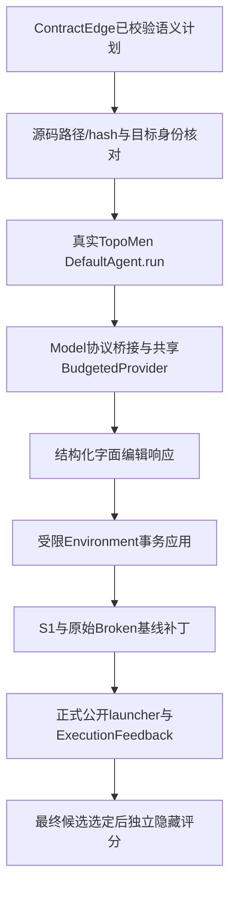

# TopoMen 真实源码审查与 ContractEdge 接入验收

更新：2026-10-19T22:06:15.921829+08:00。当前ContractEdge版本0.3.0；上传TopoMen源码实际版本1.1.2。

## 结论

已审查上传源码的核心执行、拓扑/部署调度、记忆、配置、实验入口与测试，并以实际运行结果决定接入边界。当前第7步真实调用上传项目中的`topomen.collaboration.base_agent.DefaultAgent`，原生Agent驱动模型查询、结构化动作执行和Submitted退出，产生实际源码补丁。受限Model/Environment适配器保留ContractEdge的计划身份、事务、范围和全局预算。

TopoMen原生Docker部署调度器不接收ContractEdge语义变更；`contractedge.topomen_plan.v1`是ContractEdge自行定义的交换格式。之前把该名字解释成原TopoMen已有协议的表述不准确，本次已在README和v1.3框架规格纠正。

正式开发案例RW-CAND-130经过真实TopoMen Agent公开补丁回放、真实公开launcher及独立隐藏评分，结果PASS。回放验收使用公开确定性编辑响应，不是自主大模型成功；全150模型实验没有执行。

## 源码身份与审查范围

- 来源：用户上传至`/home/xhj/contractedge-integrations/topomen`，不是从同名网络项目推测能力。
- 原始Python模块44个，共13901行。原始树身份：`a5b3c23cae3ef62ea7d740d8f9e58bf51f1018cf1e5052e5a62fb86049a5e369`。
- 修复后运行树身份：`3dfc43754d4bae6dbc99051ed607d4cc756b26049b79b7f5cc2f9865ee17b2dd`。完整原始/现状文件清单及4模块兼容性补丁在本报告目录。
- 版本以`src/topomen/__init__.py`的1.1.2为准；README的1.1.1、153测试及4命令说明是陈旧信息，已更新为实际1.1.2、168测试与5个入口。
- 读取了AGENTS、overview、progress、experiment_protocol、迁移记录和最新部署/回退研究日志；旧实验成绩只作为历史叙述，本次没有把它们计入正式150。

## 核心能力的实际核对

| 模块 | 源码事实 | 对当前接入的含义 |
| --- | --- | --- |
| `collaboration/base_agent.py:75` | 原生run→step→query→execute_actions，支持Model/Environment协议及轨迹序列化 | 真实复用其Agent循环；不是仅在本地消费者上改名 |
| `topology/build_topology.py:299` | 从项目路径扫描Python依赖、入口、系统包及运行验证计划，生成BuildTopology | 可用于部署分析，不替代ContractEdge的U/E/V/C/P语义计划 |
| `topology/scheduler.py:142` | 接收BuildTopology，围绕Dockerfile、docker build/run、分支构建与缓存调度 | 不直接承担150条多语言/Helm案例的修复判定 |
| `memory/` | Repair/Pattern/Runtime Validation分层记录与检索；有置信度、跨项目与生命周期限制 | 新源码执行端不启用独立共享记忆，避免改写当前方法输入与实验边界 |
| `collaboration/review.py` | verifier核对错误类型/节点，critic过滤失败/重复/空修复记录 | 不把这些规则型检查提升为正式案例的隐藏语义oracle |
| `llm/`和`environment/` | 通过模型接口生成动作、执行环境返回观察；原部署配置要求Python项目Docker环境 | 新桥接继续使用ContractEdge既有模型端和预算，避免第二套LLM循环和命令环境 |

## 真实复现的问题与处理

| 发现 | 实际证据 | 当前处理 |
| --- | --- | --- |
| Python版本声明不符 | pyproject声明>=3.10，4模块导入3.11才有的datetime.UTC；本服务器原始pytest9个收集错误 | 改用timezone.utc；原始文件和patch保留，原生全suite168通过 |
| 部署规划与Helm任务不匹配 | 对正式RW-CAND-130源码实际静态规划：python_files_scanned=0、mode=noop、命令print('container ready') | 第8步继续使用正式公开launcher；不把该部署smoke当作案例行为通过 |
| LocalEnvironment超时边界不足 | timeout=0.05秒返回TimeoutExpired，但子Python进程0.7秒后仍写入标记文件 | 新执行端不使用该shell环境，使用只接受计划内字面事务的受限Environment；原部署路径子进程治理仍属单独整改项 |
| checkpoint不是源码树回滚 | 真实临时工作区checkpoint后修改Dockerfile及main.py，回滚只恢复Dockerfile | 源码修改采用ContractEdge原子事务、隔离工作区与原始Broken基线补丁；不冒称旧scheduler具有全仓库回滚 |
| 全局配置自动载入 | TopoMen import会读取机器全局.env | 适配器import期间指向自有空临时目录，恢复原环境；Model/Environment模板变量不包含os.environ |
| 哈希与旧pyc可能不一致 | 独立副本保留同mtime/size缓存：磁盘n_calls=0、源码hash匹配，实际实例n_calls=9 | 独立审查复现后加入空临时pycache、导入后源码复核及回归；修复后实际为0 |
| 多轮轨迹可能错配 | 首轮Submitted后，次轮前置拒绝仍持有旧last_trace | 每次execute入口清空轨迹，回归验证不把旧成功轨迹附到新失败轮 |

上述LocalEnvironment和Dockerfile-only回滚是原部署路径的实际边界；本次没有宣称整个TopoMen部署系统已被全面修复，也没有启动昂贵的旧部署实验。新接入使用受限协议端口，不调用这些不适配的路径。

## 第7步当前实际调用链

真实Agent路径：`/home/xhj/contractedge-integrations/topomen/src/topomen/collaboration/base_agent.py`。实际执行入口记录`api_calls=1`、`exit_status=Submitted`、`status=APPLIED`。模型循环不重做诊断；每轮执行最多一次查询，外层ContractEdge继续负责EXECUTE/CHANGESET/DIAGNOSIS路由及义务保留。Agent的instance_cost=0表示禁用第二套金额预算；正式token/time/call以共享模型账本为准。

开发默认配置选`execution_backend: topomen_agent`，源码路径/hash显式绑定，缺失或漂移时失败，不静默回退。`direct`保留为显式历史后端。TopoMen依赖安装在`.topomen-deps`，锁定13个依赖版本，不覆盖冻结工具所需的系统PyYAML5.4.1。

## 实际验收与测试

- 上传原始源码：Python3.10 pytest9个收集错误，日志`pytest-native-python310.log`。
- 修复并正确激活隔离虚拟环境后：TopoMen原生168/168通过；ruff通过。首次未激活PATH的10个测试失败记录也保留，原因是测试子命令使用python；未通过改测试掩盖。
- ContractEdge当前全suite181/181通过，包括7项真实TopoMen Agent专项。独立审查复跑7项，并确认两项Important修复后未发现Critical/Important残留。
- 源码编译及git diff --check通过；CLI入口帮助命令通过。
- RW-CAND-130回放验收：实际TopoMen Agent→受限事务→1474字节补丁；公开6/6调度字段匹配，禁用对照目标Job为0。
- 候选选定后独立冻结score_case.py：**PASS**，reason_code=`ALL_EXPECTED_CELLS_MATCH`。补丁SHA256：`c5006ae25d78c4ba5e16a2a105452fa94b00af187a3f8d5211085a7c4f492b49`。

关键产物：

- `/home/xhj/contractedge-system/outputs/benchmark150-native-topomen-acceptance-20261019/consumer-execution.json`：实际执行与原生Agent来源。
- 同目录`topomen-native-trace.json`、`model_calls.json`、`execution-feedback.json`、`selected-candidate.json`、`candidate.patch`。
- `/home/xhj/contractedge-system/outputs/benchmark150-independent-native-topomen-score-20261019/score.json`：独立行为评分。
- `/home/xhj/contractedge-system/outputs/topomen-native-system-tests-20261019.log`：181项全suite。
- 本报告目录`audit-probes.json`、`acceptance.json`、`python310-compatibility.patch`、失败及最终测试日志：审查复现与处理证据。

## 后续实验边界

本次确认了第7步已经真实接到TopoMen Agent，且可在正式开发案例上产生有效补丁和公开反馈。完整自主模型的诊断/计划/补丁/反馈成功仍需独立验收；公开回放PASS不能当作自主模型成功率。正在运行的v5使用原冻结0.2.2/direct后端，不会被本轮修改偷换成新后端实验。后续真实模型实验须冻结0.3.0及新的native profile，仍以正式150清单为唯一分母。
