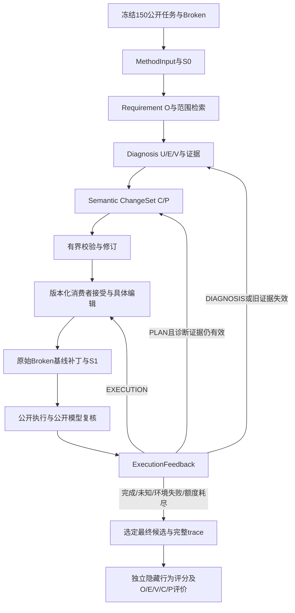

> 历史框架快照。当前真实TopoMen接入规格见 [v1.3](ContractEdge_Current_Framework_v1.3.md)。

# ContractEdge 当前框架与验收口径 v1.2

日期：2026-10-19。本文覆盖用户流程图0–10。原v1.1前三阶段规格保留为历史设计依据；当前数据唯一基准为 `ContractEdge-benchmark150-v1-20261019/RELEASE_ENTRY.json`，每类30、合计150。旧结果仅作参考，不沿用旧117/147分母。

## 阶段、职责与实现

| 阶段 | 实现 | 明确边界 |
| --- | --- | --- |
| 0 可信准备 | `dataset/benchmark.py` | 校验冻结清单、公开task与source身份；不读GT导出MethodInput |
| 1 MethodInput / S0 | `contracts/validation.py`、`dataset/archive.py` | 归一源码根与文件哈希；公开缺少commit时明确使用archive-sha256身份，不从私有修复反填 |
| 2 Requirement / O | `requirement/normalize.py` | 固定原文与来源；粗粒度O及Diagnosis提出的原子义务保持来源引用 |
| 3 检索 | `source/*`、`retrieval/*` | 路径/概念种子、语法或词法单元、一跳、Top-N、预算；截断不证明不存在 |
| 4 Diagnosis / U E V | `diagnosis/*`、`orchestration/runner.py` | 生产角色、关系、违反、证据、覆盖与不确定性分开；确定性验证不证明因果正确 |
| 5 Semantic ChangeSet / C P | `changeset/*` | EXISTING/NEW、变更依赖、修复/保留/开放义务；完整实现代码留给消费者 |
| 6 校验与修订 | `contracts/validation.py`、`orchestration/runner.py` | 有限纠错保留草稿与累计反馈；一次证据扩展及一次计划修订共用本轮预算 |
| 7 计划消费与实际编辑 | `execution/topomen.py` | 接受版本化TopoMen交换契约，绑定实际snapshot/目标hash，按依赖消费；只执行计划内字面文件编辑 |
| 8 新源码与公开执行 | `execution/public.py` | 原始Broken为补丁基线；公开工具在副本运行，S1不混入编译副作用；统一发布launcher覆盖普通/专用家族 |
| 9 ExecutionFeedback | `orchestration/feedback.py`、`orchestration/repair.py` | from/to snapshot、patch hash、公开证据、待办、保留候选、失败类型、路由、置信度与全局预算 |
| 10 独立评价 | `evaluation/benchmark.py`及发布包评分器 | 当前150固定分母；关系GT资格按实际声明；最终行为评分独立进程运行，不作为方法反馈 |

第7步由新的 `contractedge.topomen_source_consumer.v1` 承接源代码修复。它实现TopoMen交换边界，但不冒称旧部署拓扑/记忆调度器已经运行。转换对象中的初始UNVERIFIED状态与实际 `consumer-acceptance.json` 分别保存；后者绑定plan digest和目标内容，并有真实APPLIED记录。

## 迭代不变量

1. 原始Requirement、来源、MethodInput.input_digest和S0固定。S1/S2改变时，不通过重写MethodInput把新树冒充原始Broken。
2. 重新诊断必须读取当前树，RunContext记录round_id与parent_snapshot。旧SOURCE_SPAN与旧公开运行结果不得只改snapshot标签后重用。
3. Execution重试可以保留语义意图，重新绑定实际目标字节；旧诊断保持历史身份。新建文件已落地时，消费者明确记录后续具体编辑的CREATE→MODIFY转换。
4. 计划问题优先修订计划；源码变化导致旧诊断证据失效时，明确转诊断。环境失败不归为诊断错误；UNKNOWN停止。
5. 已通过公开模型复核的义务作为带snapshot和支持方式的保留候选传递。后续编辑后仍需复核，不能把模型意见提升为隐藏oracle事实。
6. 所有模型调用共享token/时间/次数预算；续跑扣除已消耗预算。最多一轮扩展、一次C修订；不能以新run/round逃逸。
7. 候选补丁相对最初Git基线；中间失败补丁、修订及原始观察均保留。隐藏结果不得用于挑选最优候选或喂回修复模型。

0.2.2验收补充：跨轮保留候选独立持久化，公开复核包自动补入旧P及已通过的保留约束；即使当前复核FAIL/UNKNOWN仍不删除。新计划未逐字重复旧P不能绕过检查。历史原子义务ID不伪装成新Diagnosis引用。前半`run`与完整`repair`均执行次数和时间上限，HTTP等待不得超过剩余时限，迟到响应不得成为READY。`max_context_tokens`是序列化规划输入预算；显式`model_context_tokens`另约束输入加保留输出的真实窗口，执行/复核沿用更保守的完整上下文检查。

## 检索和公开观察

Python使用标准库AST，Go/JS/TS/C/Java使用显式标记的词法边界，YAML/JSON使用节点树，Helm保留模板/文本来源。无法解析时返回标记过的有界文本回退。C/Java词法提取不等同完整编译器AST，也不能据此宣称全仓库召回充分。

长Helm输出会在CRD后面才出现目标Job。公开运行器保留原输出身份，增加从完整公开渲染解析出的资源计数、资源索引和部分pod字段；没有预置期望答案。模型证据优先保留各场景索引头和与公开需求有关的片段，包括非触发对照。截断标志和全文件/全解析状态明确记录。

公开模型复核逐P/保留约束输出PASS/FAIL/UNKNOWN，并引用新观察中的原文。它用于方法内部路由，属于不确定信号；最终修复是否满足案例契约仍看独立隐藏评分。

## 数据与指标

`prepare-benchmark`只枚举当前manifest，使用只读归档投影并流式计算S0，不同时展开150源码树。`repair`从冻结公开包准备独立可编辑工作区，接入同包统一公开launcher及方法中立patch协议。

`evaluate-benchmark`在评价侧读取冻结私有清单，核对GT身份，保留未运行成员。关系散文与缺失端点保留为待裁定内容，不凭字符串生成伪GT。未声明P/R资格保持unknown；这不取消150条正式修复数据身份，也不改变行为修复实验分母。

每个实验应分别报告：工程有效性、结构可追溯覆盖、可核实关系质量、公开运行/复核状态、独立隐藏修复结果、环境错误、未运行案例及成本覆盖。任何单层PASS都不能替代其他层。

## 验收材料

单元/集成测试负责协议、边界与有界状态机；150条准备报告负责数据接入；真实开发案例负责实际源码→补丁→公开反馈→独立评分。三种材料分开保存。真实开发案例只说明该案例和路径的结果，不代替全150模型实验，也不能证明模型永远给出正确诊断。
