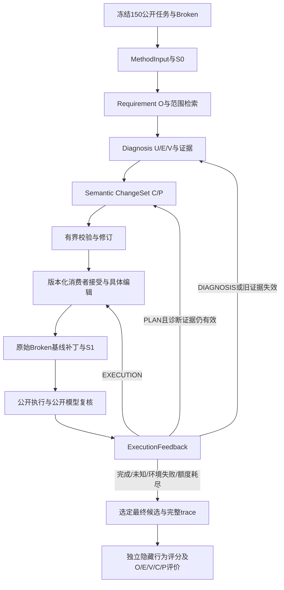

# ContractEdge 当前框架与验收口径 v1.3

日期：2026-10-20。本文覆盖用户流程图0–10。原v1.1前三阶段规格保留为历史设计依据；当前数据唯一基准为 `ContractEdge-benchmark150-v1-20261019/RELEASE_ENTRY.json`，每类30、合计150。旧结果仅作参考，不沿用旧117/147分母。

## 阶段、职责与实现

| 阶段 | 实现 | 明确边界 |
| --- | --- | --- |
| 0 可信准备 | `dataset/benchmark.py` | 校验冻结清单、公开task与source身份；不读GT导出MethodInput |
| 1 MethodInput / S0 | `contracts/validation.py`、`dataset/archive.py` | 归一源码根与文件哈希；公开缺少commit时明确使用archive-sha256身份，不从私有修复反填 |
| 2 Requirement / O | `requirement/normalize.py` | 固定原文与来源；粗粒度O及Diagnosis提出的原子义务保持来源引用 |
| 3 检索 | `source/*`、`retrieval/*` | 路径/概念种子、语法或词法单元、一跳、Top-N、预算；截断不证明不存在 |
| 4 Diagnosis / U E V | `diagnosis/*`、`orchestration/runner.py` | 生产角色、关系、违反、证据、覆盖与不确定性分开；确定性验证不证明因果正确 |
| 5 Semantic ChangeSet / C P | `changeset/*` | EXISTING/NEW、变更依赖、修复/保留/开放义务；完整实现代码留给消费者 |
| 6 校验与修订 | `contracts/validation.py`、`orchestration/runner.py` | 有限纠错保留草稿与累计反馈；一次证据扩展及一次计划修订共用本轮预算 |
| 7 计划消费与实际编辑 | `execution/topomen_agent.py` → 真实TopoMen `DefaultAgent` → `execution/topomen.py` | ContractEdge自定义计划经适配进入实际Agent；共享模型预算，受限环境按依赖执行字面事务；绑定源码身份、snapshot与目标hash |
| 8 新源码与公开执行 | `execution/public.py` | 原始Broken为补丁基线；公开工具在副本运行，S1不混入编译副作用；统一发布launcher覆盖普通/专用家族 |
| 9 ExecutionFeedback | `orchestration/feedback.py`、`orchestration/repair.py` | from/to snapshot、patch hash、公开证据、待办、保留候选、失败类型、路由、置信度与全局预算 |
| 10 独立评价 | `evaluation/benchmark.py`及发布包评分器 | 当前150固定分母；关系GT资格按实际声明；最终行为评分独立进程运行，不作为方法反馈 |

第7步默认配置`execution_backend: topomen_agent`实际调用`/home/xhj/contractedge-integrations/topomen/src/topomen/collaboration/base_agent.py`中的`DefaultAgent.run/query/execute_actions`。`contractedge.topomen_plan.v1`由ContractEdge定义，不是TopoMen原生协议。Model桥接共享BudgetedProvider，Environment只允许一次计划内文件事务；外层ContractEdge继续控制反馈迭代。轨迹记录真实Agent/module路径、源码树hash、实际APPLIED和Submitted。

原TopoMen的Python环境部署`TopologyScheduler`会生成Dockerfile，对当前Helm案例的静态规划为noop，不能充当正式案例的语义验证器。第8步仍使用冻结发布包公开launcher。直接源码消费者保留为显式`direct`后端；请求真实TopoMen时，缺失依赖或源码身份漂移立即失败，不能静默回退。

审查修复了TopoMen四模块的Python3.10 UTC兼容性。接入层另外防止旧pyc绕过源码hash、隔离全局.env，并在每次执行前清空旧轨迹。源码审查及真实回放验收见`docs/reports/2026-10-19-topomen-source-audit-and-integration.md`。

## 迭代不变量

1. 原始Requirement、来源、MethodInput.input_digest和S0固定。S1/S2改变时，不通过重写MethodInput把新树冒充原始Broken。
2. 重新诊断必须读取当前树，RunContext记录round_id与parent_snapshot。旧SOURCE_SPAN与旧公开运行结果不得只改snapshot标签后重用。
3. Execution重试可以保留语义意图，重新绑定实际目标字节；旧诊断保持历史身份。新建文件已落地时，消费者明确记录后续具体编辑的CREATE→MODIFY转换。
4. 计划问题优先修订计划；源码变化导致旧诊断证据失效时，明确转诊断。环境失败不归为诊断错误；UNKNOWN停止。
5. 已通过公开模型复核的义务作为带snapshot和支持方式的保留候选传递。后续编辑后仍需复核，不能把模型意见提升为隐藏oracle事实。
6. 所有模型调用共享token/时间/次数预算；续跑扣除已消耗预算。最多一轮扩展、一次C修订；不能以新run/round逃逸。
7. 候选补丁相对最初Git基线；中间失败补丁、修订及原始观察均保留。隐藏结果不得用于挑选最优候选或喂回修复模型。

0.2.2验收补充：跨轮保留候选独立持久化，公开复核包自动补入旧P及已通过的保留约束；即使当前复核FAIL/UNKNOWN仍不删除。新计划未逐字重复旧P不能绕过检查。历史原子义务ID不伪装成新Diagnosis引用。前半`run`与完整`repair`均执行次数和时间上限，HTTP等待不得超过剩余时限，迟到响应不得成为READY。`max_context_tokens`是序列化规划输入预算；显式`model_context_tokens`另约束输入加保留输出的真实窗口，执行/复核沿用更保守的完整上下文检查。

## 检索和公开观察

Python使用标准库AST，Go/JS/TS/C/Java使用显式标记的词法边界，YAML/JSON使用节点树，Helm保留模板/文本来源。无法解析时返回标记过的有界文本回退。C/Java词法提取不等同完整编译器AST，也不能据此宣称全仓库召回充分。

长Helm输出会在CRD后面才出现目标Job。公开运行器保留原输出身份，增加从完整公开渲染解析出的资源计数、资源索引和部分pod字段；没有预置期望答案。模型证据优先保留各场景索引头和与公开需求有关的片段，包括非触发对照。截断标志和全文件/全解析状态明确记录。

公开模型复核逐P、保留约束及OPEN义务输出PASS/FAIL/UNKNOWN，并引用新观察中的原文。它用于方法内部路由，属于不确定信号；最终修复是否满足案例契约仍看独立隐藏评分。

## 数据与指标

`prepare-benchmark`只枚举当前manifest，使用只读归档投影并流式计算S0，不同时展开150源码树。`repair`从冻结公开包准备独立可编辑工作区，接入同包统一公开launcher及方法中立patch协议。

`evaluate-benchmark`在评价侧读取冻结私有清单，核对GT身份，保留未运行成员。关系散文与缺失端点保留为待裁定内容，不凭字符串生成伪GT。未声明P/R资格保持unknown；这不取消150条正式修复数据身份，也不改变行为修复实验分母。

每个实验应分别报告：工程有效性、结构可追溯覆盖、可核实关系质量、公开运行/复核状态、独立隐藏修复结果、环境错误、未运行案例及成本覆盖。任何单层PASS都不能替代其他层。

## 验收材料

单元/集成测试负责协议、边界与有界状态机；150条准备报告负责数据接入；真实开发案例负责实际源码→补丁→公开反馈→独立评分。三种材料分开保存。真实开发案例只说明该案例和路径的结果，不代替全150模型实验，也不能证明模型永远给出正确诊断。

## 2026-10-20真实运行后的约束补充

- 大体积ExecutionFeedback向模型提供保留全部检查、待办、保留项及原始观察引用/摘要的投影视图；完整原始反馈保存在磁盘。诊断、计划修订、执行均使用这一投影，不通过裁掉未完成义务解决上下文问题。
- 公开审查的格式或引用错误允许配置限定的纠错重试，保留被拒草稿及准确错误；检查集和观察不变，仍共用调用、token、时间、金额预算。无效引用仍拒绝。
- OPEN只有在当前S1公开执行成功、独立检查明确PASS且提供该观察中的有效原文证据时才解除待办，并转入后续必须复核的保留候选。此结果不改写原始READY_PARTIAL计划，也不证明最初诊断的因果正确性。
- 补充检索可在已确定的种子文件中恢复变量/闭包使用及长函数尾部查询窗口；有界原文回退明确标记，保留真实行号和哈希，不扩大为无边界仓库搜索。一次扩展及原范围预算不变。
- 原有空响应恢复策略保持兼容：同一源码snapshot、输出截断且全部completion token为reasoning时，可显式启用局部关闭thinking。0.4.2另提供execution_truncation_retry：同一snapshot的完整返回被输出上限截断、reasoning占completion至少一半时，允许对空或部分JSON局部关闭thinking重生成。execution_format_retry_in_round将原有一次执行格式纠错放在同一语义轮内；仅针对已返回响应且源码未改变，绝不自动重放未知HTTP结果。调用、token、时间、费用及输出上限不增加，后续阶段恢复全局thinking配置。
- development_only由核心入口按冻结partition/member_groups.jsonl及其SHA校验，当前实际标签为development / validation / blind_test（115/18/17）。非开发案例在输出或计费调用前被拒绝。正式配置保留完整150条成员。
- 正式入口scripts/run_formal150.py冻结方法源码与配置，默认仅生成150条NOT_RUN的零调用预检；执行必须匹配就绪凭据中的源码、配置及启动器哈希。所有阶段沿用同一总账（用户于2026-10-20将总上限从20元提高为80元，历史费用与待结预留继续计入），达到上限停止，不能以新目录重置费用；批次恢复不自动重放扣费可能不明的中断案例。

优化前历史小批量记录为outputs/deepseek-development-pilot-v7-20261020。5条全部终态：2条公开闭环并独立行为评分PASS，2条EVIDENCE_GAP，1条INVALID_OUTPUT。后3条不计为成功；其失败表明当前方法局限，不应通过放宽契约、扩大检索额度或隐藏评分反向调整来抹去。该工程验收不等于全150条已运行或全部可修复。

## 0.4.2系统优化实施

三项核心能力为Diagnosis的有界关系证据、可追溯Semantic ChangeSet和有当前snapshot证据的执行反馈。详情与验收见outputs/system-optimization-20261020/。新增公开能力摘要、候选重叠软惩罚与跨文件覆盖、精确同缺口只读扩展、独立错误汇总、义务/关系/保持条件传递、受限只读执行支持、声明输入与实际输出的确定性字段比较。所有PASS/FAIL必须有当前观察的精确原文支持，明确不可公开观察的义务跨轮次保持UNKNOWN。构建通过不解除运行时义务。

正式150条与消融仍暂缓；旧正式就绪凭据对应旧方法身份，不能作为0.4.2已完成正式实验的证据。开发验证保留失败和未运行成员，不以单次成功推断普遍效果。

0.4.3补充：公开复核同样复用原一次格式纠错，汇总可独立检查的引用/比较错误，并反馈失败比较的状态及公开指针。显式review_truncation_retry允许reasoning占主导的已返回截断响应在同一观察上局部关闭thinking重生成；无新增HTTP自动重试或调用/轮次上限。严格原文引用、确定性比较和不可观察标记继续有效。

## 0.4.4 验收问题修复（开发验证中）

公开观察的evidence_kind由公开运行器生成；构建/执行状态不能作为结构或运行时行为证据，未登记的观察能力保持未知。公开复核和反馈接收共用能力、场景/资源及字段比较门禁。DECLARED_INPUT_EQUALITY要求计划预先声明comparison_requirements，所有必要绑定必须覆盖，比较值只来自公开输入与实际输出；相等支持PASS，不相等可支持FAIL。绑定本身仍不证明语义相关性。历史义务的场景和比较约束跨轮保留。

取证支持规范目录加同一缺口查询，仍是只读定位，不增加编辑权限或伪造语法边；候选池交错与新增缺口价值排序保持Top-N和预算。计划其他字段有错时，独立合法且身份绑定的缺口可在原唯一修订前取证，原错误保留；不自动新增第三次计划。具体编辑保存semantic_edit_trace，有界实际old/new与意图映射供公开复核参考，不当作运行时证明。

详见outputs/acceptance-optimization-20261020/。当前正式实验就绪仍为false；实际效果由固定候选开发评分确认。

0.4.5补充：同一次复核可同时引用总索引和目标资源记录；只要存在满足场景/资源边界的实际证据，额外索引不否决它。字段比较仍须绑定符合目标边界的记录，错误场景或资源不能替代。0.4.4首次真实运行与0.4.5修正后新运行分别留档，不覆盖历史。

0.4.6补充：公开可编辑范围前移至计划候选与验证，同一权限函数继续在消费端复查；只读参考正文仍可进入诊断。针对实际长函数前缀缺口，单个已定位的截断声明可在默认512行及16K字符内恢复，保留新ID与父片段关联；max_gap_declaration_lines可显式收紧，最终完整请求预算仍有效。完整声明获得软排序偏好，不强行占据Top-N。

0.4.7补充：显式planning_truncation_separate_allowance=true时，每次front-half至多一次已返回、reasoning占多数的length响应恢复，独立于原合同纠错额度；默认false保持共享旧纠错额度。仍受全局12次调用、token、时间与80元历史共用总账约束。恢复只改变当次thinking，不改变schema、snapshot和证据；未知HTTP结果不自动重放。新增调用与恢复/纠错索引分别记录，不能把技术恢复称为新的因果证据。

## 0.4.8–0.4.9 生产路径与方法侧公开探测（开发验证中）

已连接文件内的同缺口查询可以取得通过辅助函数间接到达的同文件消费者；该关联标为LEXICAL_CONNECTED_FILE_QUERY，不冒充语法/因果边，不扩大可编辑范围。同文件、命中公开标识符且共享多个调用的已入选正文形成最多12项词法清单。诊断使用该清单，计划以production_path_review逐项说明MODIFY/PRESERVE/OUT_OF_SCOPE/UNRESOLVED；修改需指向该分支范围中的真实C，未解决需指向真实开放义务。引用齐全不证明语义正确，缺失/截断正文仍是覆盖边界。

method_probe_profiles是独立的方法配置，不改冻结公开环境或评分器。首个注册家族kpt-configpath-v1使用公开Renderer API、临时KRM包与本地FunctionRuntime替身，检查9项所属函数配置绑定/普通输入隔离、后续可见性、最终资源及无configPath对照。程序源码随方法摘要冻结；只读执行副本复用公开镜像、依赖、资源和无网络隔离。探测不写入候选补丁，无私有断言或Fixed。局部替身不等于外部容器/WASM运行效果。

完整注册探测产生PUBLIC_BEHAVIOR，携带固定检查ID、程序摘要及源码快照；行为失败与探测编译/环境/输出错误分开。C/P/保持项/开放义务用behavior_check_refs预先绑定检查，失败记录不能支持PASS，无关对照不能替代必要检查。绑定跨轮保留，接收端再次验证。冻结launcher能力与额外method_behavior_probes能力分别记录，不把build-only合同改称行为验证器。

0.4.8真实开发运行在取证后诊断的多端点DIRECT_EDGE错误处停止，此前纠错机会已消耗。0.4.9显式diagnosis_format_retry_per_context允许初始诊断及唯一取证扩展后的新证据上下文各一次合同纠错；默认保持旧共享额度。没有自动拆边、放宽生产路径或新增检索轮次，12次总调用、时间/token及80元历史共用总账继续约束；未知HTTP不重放。

记录与原始对照见outputs/production-path-behavior-20261020/。正式150和消融尚未派发，当前开发结果不构成普遍或显著修复率提升证明。

0.4.10补充：注册方法探测实际调用的公开API可以提供额外只读入口线索。限定公开包内声明定位，最多128文件/4MiB；相关声明及相邻调用最多8项进入原80候选池，最终Top-N和上下文预算不变。来源为METHOD_PROBE_PUBLIC_API加程序摘要，不是预设修复分支/答案或新的编辑权限。首次诊断请求捕获已取得两个分支、runPipeline与Renderer入口正文片段（截断状态保留）；实际首诊合法并进入同时处理两个分支的计划，效果仍等待补丁/行为/独立评价。

### 0.4.11 执行前提取证与审查修复

在既有生产路径与公开行为验证之上，执行请求从接受目标的直接Go限定调用和本模块import读取辅助函数声明及邻接前提注释，受24K字节支持预算、128文件/4MiB扫描和8片段上限约束；不扩大编辑策略。只对具体编辑阶段显式关闭thinking，其余阶段保持原配置。修复同一义务保持/待办绑定覆盖、候选改名跳过探测、非连续源码包络虚报分支修改；冲突观察边界不判PASS。探测集合在Broken准备时冻结，各轮复用。候选与探测共享进程，输出不防恶意伪造，方法探测不代替独立评分。

完整316项测试与14子测试通过；实际开发复测仅原RW130/KPT，最终结果及失败见outputs/production-path-behavior-20261020/IMPLEMENTATION_REPORT.md；不得据小样本宣称显著修复率提升或150就绪。

### 0.4.12 绑定行为失败后的有界执行优先路由

首轮已改变候选、构建成功、注册方法检查证实已接受的后置条件或保持约束失败时，仅凭模型提出的PLAN/LOW不足以证明原语义意图错误；先在原权限与原计划内使用既有第二轮执行机会。保持原提交归因与LOW，rationale明确这是操作性路由策略而非因果证明；不适用无变更、开放项、UNKNOWN或后续轮次。不增加12调用/2语义轮上限。审查请求解释EXECUTION/PLAN/DIAGNOSIS/UNKNOWN含义；根轨迹传播重诊校验错误。真实公开反馈零HTTP回放维持5项未完成义务，路由CHANGESET→EXECUTE。319项测试及14子测试通过，最终真实结果单列记录。

### 0.6.9 对执行优先策略的公开进展校正

执行优先不能无限重复无效意图。对已绑定的 PUBLIC_BEHAVIOR 后置条件，使用同场景、同探测摘要、同输入和环境、各自当前快照的结果比较。全部目标均可比较、仍有被当前评审引用的目标失败，且原先失败的目标没有任何一项变为 PASS 时，将既有下一轮送到 DIAGNOSIS/LOW，复核当前源码中的原因、生产路径和计划。记录 `predicate_progress_comparison`，保留原失败、快照和原路由；此选择不证明唯一根因。

部分目标已改善、实现已有明确辅助前提 CONFLICT，继续使用执行路线。未绑定、不同场景、缺失结果、UNKNOWN、旧快照、不同探测或环境不用于推断“没有进展”。正常预期异常及无关对象也不能借此升级为缺陷。原调用和语义轮次上限保持，保持条件退化仍由候选门独立拒绝；目标进展不能抵消保持失败。工程回放证明路由生效，真实修复效果按冻结版本单独验收。

## 0.5.5 完整优化交付与实际验收补充

以下约束补充当前0—10框架，旧版运行按旧语义解释，不重写历史记录。

- 公开JSON输出适配器只由冻结公开生产者身份选择，首批KOPF对象与Provider Helm本地传输。完整对象解析后才做上下文选择，原始摘要、对象/场景/位置保留；stdout自报类型或PASS不授予能力。Helm完整解析产生场景概览、精简完整kind枚举和pod记录；有界展开List，不完整/失败/超时不能证明不存在。
- 原文子句偏移与精确source_quote、可选scope_quote提供runner生成的稳定义务身份；共享原文锚点保留所有语义陈述，不自动推断等价。历史检查/作用边界累积，变更锚点不自动删除旧待办。preservation_impact必须说明CHANGES或GLOBAL范围，影响关联不是根因证明、不跳过保持复核。
- 新追溯计划绑定方法探测须声明ALL_OF、NECESSARY_ONLY或SUPPORTING及理由。明确必要检查失败可否定；部分必要通过不能证明整体通过。当前快照机械汇总与模型解释分开，模型处理未覆盖语义，不可覆盖已知机械失败。检查绑定充分性仍是语义声明，不是自动语义完备证明。
- 配置消费者和注册公开API提供有界只读取证提示；Go/Python直接辅助调用提供前提上下文。保持Top12和扫描/请求预算，不扩大编辑权限，不把词法提示伪称语法或因果边。
- EXECUTE续修仅附带同snapshot的上次格式错误草稿，已应用于旧S0的成功响应不能与当前S1源码竞争。精确锚点错误记录change_id、path、edit_index、matches；不采用模糊替换，保留整批预验证及写入回滚。
- kpt-configpath-v2将原聚合保持检查拆为14项有界观察，v1程序身份保留。alertmanager-reload-v1采样真实本地生产进程在20次有效重载中的分组可见性，128组/4采样器/2ms目标间隔；采样成功不能证明所有未采样瞬间，公开能力边界和PROBE_ERROR必须保留。

0.5.5源码摘要`3e523afe3a4888e7797e93d20e106893fe29c4d4af9b4356deec062c2d9aa4eb`；配置`configs/deepseek-development-final-v1-budget80.json`。362工程测试与22子测试通过，固定开发7条同版独立5PASS/2无候选；单列公开失败续修独立SEMANTIC_FAIL。三核心已实际驱动决策，但诊断与恢复效果仍有限，不标记正式实验就绪。逐步验收、能力矩阵、独立评分和失败报告见`outputs/final-optimization-20261020/`。本轮未启动新正式150或消融，不宣称显著修复率提升。
